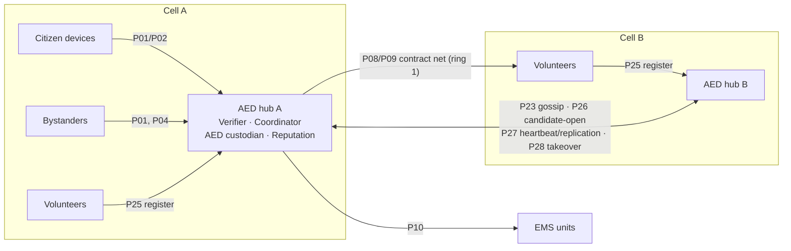

# Architectural Design

ISIA 2026/27 · Assignment 1 · Topic O · Gaia phase 2 of 3

The analysis ([01-gaia-analysis.pdf](01-gaia-analysis.pdf)) defined 12 roles (R1–R12), 24 protocols
(P01–P24), the organisational rules OL1–OL9 and OS1–OS13, and left eight decisions open (D1–D8,
analysis §9.2). This phase chooses the organisational structure, resolves those decisions, completes
the role and interaction models and says where each rule is enforced. Agent and services models are in
[03-detailed-design.md](03-detailed-design.md); message schemas in
[04-protocols-and-messages.md](04-protocols-and-messages.md).

## 1. Organisational structure

### 1.1 Topology: a light hierarchy of cell hubs

The 3 × 3 km city is partitioned into Voronoi **cells** around the public AED cabinets (10 in the base
scenario, about 0.9 km² each). Each cabinet is the **hub** of its cell: it verifies the cell's alerts,
owns the resulting cases and keeps the trust table of the sources and responders registered with it.
Hubs whose cells share a border are neighbours and treat each other as peers. Responders are never
ordered: the hub calls for proposals and they decide whether to bid. The partition is computed by
every agent from the public road network and AED registry.

| Relationship | Control regime |
|---|---|
| Source → hub | Hierarchical: one verifier per area, so de-duplication and OS7 are structural |
| Hub ↔ hub | Peer to peer: only gossip, duplicate resolution and succession |
| Hub → responders and EMS | Market (Contract Net): responders bid and may refuse |

### 1.2 Why this structure

Gaia chooses the structure by weighing efficiency, the real-world organisation and the rules to
enforce (Zambonelli et al., 2003). The analysis named three candidates (D1):

| Criterion | (a) Collective of peers | **(b) Cell hubs** | (c) Ephemeral coordinator per case |
|---|---|---|---|
| OS1 one owner per case | Consensus per case | **Structural; failover by lease (D8)** | Leader election per case |
| OS7 alerter does not verify | Checked per case | **Structural: hubs never alert** | Exclude the alerter from the election |
| OS13 trusted coordinators | Any device | **Provisioned infrastructure** | Elected device must clear `τ_min` |
| Messages per incident (M8) | High | **Low (star in cell + ring-1 calls)** | Medium |
| Real-world fit | — | **Cabinets are fixed, powered and networked** | Phones have limited battery and coverage |

Only (b) makes the three hardest safety rules hold by construction. It stays decentralised: no agent
sees the whole city or decides for another cell, and a failed hub only affects its cell until a
neighbour takes over. Option (c) remains an extension for cells whose cabinet is offline.

## 2. Resolved design decisions (D1–D8)

**D1 Topology.** Cell hubs on AED cabinets, Voronoi cells, neighbouring hubs as peers (§1).

**D2 Verifier and coordinator.** The hub of the cell where the first alert of a candidate is raised
plays both roles. P06 and P07 become internal hand-overs, still written to the audit log (OS10). OS7
only forbids the alerting source from verifying, so this does not break it.

**D3 Discovery without positions.** Volunteers register (P25, FIPA-Subscribe) with every hub up to ring
2 of their cell; bystanders and devices up to ring 1. A registration carries the pseudonym,
qualification, cell and ring distance, never coordinates. Calls (P08) go to ring ≤ 1 and widen to ring 2
if nobody bids. Ring 1 covers about 1.5 km, inside the 1.3–2 km alert radius of real systems. XMPP
presence is not used: it is reported unstable in SPADE's embedded server and would broadcast
availability to every subscriber.

**D4 Allocation.** FIPA Contract Net (P08 → P09) with controlled redundancy. Volunteers bid their ETA,
computed on their own phone. The hub ranks bids by
`score = ETA × (1 + λ_q·[below needed qualification]) / trust^β` and awards the best `k` per task (P1:
2 × `GO_TO_PATIENT` + 1 × `FETCH_AED`, at most `N_max = 4`). Low trust delays a volunteer, it does not
exclude it. Under contention a hub serves its calls in priority order, and a volunteer confirms only
its first award (OS2). Ambulances use the same Contract Net (P10). Baseline B1 replaces all of this with
"alert everyone in range, first to accept goes".

**D5 Evidence fusion.** Per candidate the hub keeps `L = logit(prior)` and adds
`trust(s) · log LR(evidence)` for each piece of evidence. With unit weights this is the naive Bayes
update; weighting by trust is a heuristic (a tempered likelihood). A source counts once per candidate.
The candidate is declared when `σ(L) ≥ τ_declare(p)` and OS4 holds, and discarded when `W_max(p)`
expires. The sensor policy (`AlertFirst` or `ConfirmFirst`) is a scenario parameter.

**D6 Trust.** Beta reputation per stable pseudonym, `trust = (α + 1) / (α + β + 2)` (Jøsang and Ismail,
2002). P21 outcome labels update α and β, with the EMS clinical confirmation as reference; counts decay
towards the prior. New pseudonyms start at the prior (OS13). Neighbouring hubs gossip `(pseudonym, α, β)`
through P23 with a fixed discount `d = 0.5`; hubs trust each other, so no per-peer trust is kept.

**D7 Privacy.** Sources and responders have stable pseudonyms; patients and witnesses get one per case.
Calls and bids carry only the cell. Alerts carry the cell and a coarse area (position rounded to the
100 m street grid). The coordinator obtains the precise location from the subject's PrivacyGuardian
(P24) and forwards it only inside P09 awards and the P10 award; clinical data and identity go only to
the EMS (OS5). Case data are purged at most `T_ret` after closure (OS11), and replication (D8) excludes
location and clinical data. The coarse area was added after the first experiments: with only the cell,
the hub merged alerts of the same cell into one candidate and in C3 fused different patients (03 §7.1).

**D8 Failure recovery.** Each hub has a deterministic successor (lowest-id neighbour). The owner
replicates every open case to it (P27, without personal data) and sends a heartbeat every `H = 5 s`
with a lease `L = 3H`. The successor takes over after `L + H` of silence and announces it (P28), then
re-requests the location (P24). Hubs fail by crash-stop and inter-hub links do not lose messages, so a
missing heartbeat means a crash and OS1 holds without consensus; network partitions are a stated
limitation. A source without `AlertAck` in 10 s re-sends to the successor (F6). Duplicates across a
border (F14) are resolved by P26: the candidate opened first keeps the case, the other hub forwards its
alerts and drops its copy, and the older hub answers each notice so the decision is not one-sided. Rule
DUP in the checker makes remaining duplicates visible.

## 3. Completed role model

The 12 roles are kept. The anticipated "cell coordinator" is the hub itself and the "case registry" is
replaced by P26. The roles map onto five agent classes:

| Role | Agent class | Change from the analysis |
|---|---|---|
| R1 SensorMonitor, R12 PrivacyGuardian | `CitizenDeviceAgent` | Partner of P01/P02 is the hub of the current cell |
| R2 WitnessReporter, R9 BystanderGuide, R10 OnSceneHelper, R12 | `BystanderAgent` | Adds P25; the guide runs on the witness's phone, so it works without network (F13) |
| R3 IncidentVerifier, R4 IncidentCoordinator, R7 AEDCustodian, R11 ReputationManager | `AEDHubAgent` | Verify adds P26; Coordinate adds P27 and widens P08 to ring 2; one trust table per hub with P23 to neighbours |
| R5 VolunteerResponder, R6 AEDRunner | `VolunteerAgent` | Adds P25; enforces its own caps (OS8) |
| R8 EMSUnit | `EMSAgent` | Any hub may call it (P10) |

## 4. Completed interaction model

Each protocol is bound to a FIPA interaction protocol. "Local" means both roles live in the same agent;
local exchanges are still logged.

| ID | Protocol | Initiator → partner | FIPA pattern · performatives | Scope |
|---|---|---|---|---|
| P01 | RaiseCandidateAlert | source → hub of its cell | inform → inform (ack) | network |
| P02 | CancelAlert | source → hub | inform → inform (the source reports its alert was false; FIPA `cancel` would withdraw a request) | network |
| P03 | CorroborationRequest | hub → registered sources, cell + ring 1 | Query: query-ref → inform / refuse | network |
| P04 | TriageQuestionnaire | hub → witness on scene | Query: query-if → inform | network |
| P05 | ActivateGuidance | hub → guide | Request: request → agree / refuse | network |
| P06 | DeclareIncident | verifier → coordinator | internal hand-over, audited | local |
| P07 | RetractIncident | verifier → coordinator | internal hand-over, audited | local |
| P08 | CallForResponders | hub → volunteers, ring 1 (then 2) | Contract Net: cfp → propose / refuse | network |
| P09 | AwardTask | hub → bidders | accept-proposal / reject-proposal → inform / failure | network |
| P10 | RequestAmbulance | hub → EMS units | Contract Net | network |
| P11 | ReserveAED | coordinator → custodian | Request: request → agree / refuse; cancel | network or local |
| P12 | RetrieveAED | runner → custodian | Request: request → inform / failure | network |
| P13 | StatusUpdate | responders, EMS, guide → coordinator | inform | network |
| P14 | ReleaseResponder | coordinator → awardees | cancel → inform | network |
| P15 | HelpEnRouteNotice | coordinator → guide | inform | network |
| P16 | GiveInstruction | guide → helper | request | local |
| P17 | ReportFeedback | helper → guide | inform | local |
| P18 | TakeoverFromBystander | volunteer → guide | request → inform | network |
| P19 | HandoverToEMS | EMS → volunteer or guide | request → inform | network |
| P20 | CloseCase | coordinator → participants | inform | network |
| P21 | OutcomeFeedback | coordinator → reputation manager | inform | local |
| P22 | QueryTrust | verifier / coordinator → reputation manager | read of the hub's own table, no messages | local |
| P23 | ShareReputation | hub → neighbour hubs | inform, periodic | network |
| P24 | RequestDisclosure | coordinator / EMS → subject's guardian | Request: request → inform / refuse | network |
| P25 | RegisterInCell | volunteer / witness / device → hub | Subscribe: subscribe → agree; cancel | network |
| P26 | CandidateOpen | hub → neighbour hubs | inform; older hub answers; newer sends merge | network |
| P27 | ReplicateCase | owner → successor | inform → inform (ack), with heartbeat | network |
| P28 | TakeOverCase | successor → case participants | inform | network |

P25–P28 are new, dictated by the structure (D3, D8). Every message carries the case or candidate id as
`thread` and a per-sender sequence number, so retries are idempotent (F5).

## 5. Organisational patterns reused

| Pattern | Where | Purpose |
|---|---|---|
| Hierarchy of local authorities | hub per cell | Case ownership (OS1), de-duplication, OS7 |
| Market / Contract Net (Smith, 1980; FIPA SC00029H) | P08–P10 | Allocation among autonomous responders |
| Registry with subscription | P25 | Discovery without positions |
| Primary–backup with lease | P27, P28 | Recovery without a second owner |
| Gossip with discounting | P23 | Reputation beyond local history |
| Mediated access | P24 | Need-to-know disclosure |

## 6. Where each organisational rule is enforced

`src/cemr/metrics/check.py` re-checks every rule from the event log after each run (`rules_safety.py`,
`rules_liveness.py`). The table names the mechanism meant to prevent violations at run time.

| Rule | Enforced by |
|---|---|
| OL1 alert life cycle | Per-candidate FSM: every path ends in discard or in `CloseCase` + P21; `W_max(p)` bounds it |
| OL2 ambulance in P1/P2 | First action after declaration sends P10 |
| OL3 triage → guidance | P05 sent as soon as a P1/P2 triage answer arrives, before declaring |
| OL4 only awardees act | AED unlock needs the award token; P18/P19 only in the committed state |
| OL5 only triaged witnesses are guided | P05 targets only witnesses that answered P04 |
| OL6 failure → new call | `AED_MISSING`, `WITHDRAWN` or ETA + δ exceeded re-enters recruitment |
| OL7 handover order | P18 before P19; volunteers released after P19 |
| OL8 release surplus | P14 when `N_need(p)` responders are `ON_SCENE` |
| OL9 one outcome, then purge | `CloseCase` sends exactly one P21 and starts the purge |
| OS1 one owner per case | Hub ownership + lease-based succession (D8) |
| OS2 one commitment per responder | Volunteer confirms an award only when idle |
| OS3 one reservation per AED | Custodian state machine |
| OS4 declaration rule | Fusion module (D5) |
| OS5 need to know | Guardian policy; location only in P09/P10 |
| OS6 ambulance cancellation | Only on a human-confirmed false alarm or an EMS decision |
| OS7 alerter ≠ verifier | Structural: hubs never alert |
| OS8 load caps | Volunteer refuses beyond `A_max` alerts per hour or `K_max` awards |
| OS9 preemption only P3 → P1 | EMS agent |
| OS10 auditability | Every state change and disclosure is logged |
| OS11 retention | Guardian purge after `T_ret` |
| OS12 guidance from protocol only | Guide picks steps only from `guidanceProtocol` |
| OS13 admission | Qualification credential from the scenario; hubs are provisioned |
| DUP no duplicate cases | Alert merging by area (D7) and the P26 answer (D8); added in this phase |

## 7. Failure modes

Each failure mode of the analysis (F1–F15) has an architectural answer in the decisions above: trust-weighted
fusion for false sensor and human reports (D5, D6), deadlines and idempotent retries for lost messages,
succession for hub failure (D8), re-recruitment for no-shows (OL6) and P26 for duplicates. The detection,
handling and code location of each one are in a single table, [03 §4.7](03-detailed-design.md).

## 8. Constraints from the platform (sprint 0 spike)

The scale spike ([spikes/README.md](../spikes/README.md)) fixed five constraints:

- SPADE delivers messages between agents of one process without XMPP, so latency, loss and coverage
  gaps are injected by our own network model on a single send path;
- the clock runs 10× faster than real time, where real message delays add at most ~0.3 simulated seconds;
- agents start in batches with retry, because the XMPP server drops connections in login bursts;
- each run has a private in-process XMPP server on its own port, so parallel runs share nothing;
- no XMPP presence (D3).

## 9. Variation points kept open for evaluation

Scenarios and baselines set these switches: sensor policy `AlertFirst | ConfirmFirst`; redundancy
`k ∈ {1, 2, 3}`; reputation on/off; bystander guidance on/off; allocation `contract-net | naive`
(baseline B1); and, optionally, adaptive thresholds and direct disclosure. Baseline B0, the centralised
oracle, is computed outside the agent system over the same incident trace.

## References

- Zambonelli, F., Jennings, N. R., & Wooldridge, M. (2003). Developing multiagent systems: the Gaia
  methodology. *ACM TOSEM*, 12(3), 317–370.
- Smith, R. G. (1980). The Contract Net Protocol. *IEEE Transactions on Computers*, C-29(12), 1104–1113.
- FIPA (2002). *FIPA Contract Net Interaction Protocol Specification* (SC00029H); *FIPA Subscribe*,
  *Request* and *Query* Interaction Protocols.
- Jøsang, A., & Ismail, R. (2002). The Beta Reputation System. *15th Bled Electronic Commerce Conference*.
