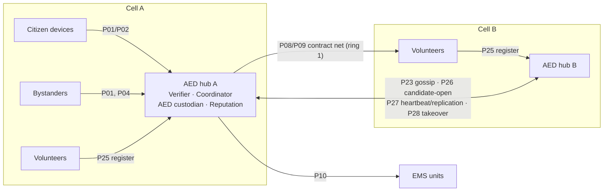

# Architectural Design — Decentralised Community Emergency Medical Response

ISIA 2026/27 · Assignment 1 · Topic O · Gaia phase 2 of 3

The Gaia **analysis** ([01-gaia-analysis.pdf](01-gaia-analysis.pdf)) produced five models without
committing to an organisational structure:

- four sub-organisations;
- an environment model with 18 resources;
- 12 preliminary roles (R1–R12);
- 24 preliminary protocols (P01–P24);
- organisational rules OL1–OL9 and OS1–OS13.

It left eight decisions open (D1–D8, analysis §9.2).

This document is the **architectural design** phase. It does four things:

1. Chooses the organisational structure: topology and control regime.
2. Names the organisational patterns it reuses.
3. Completes the role and interaction models.
4. Says where each organisational rule is enforced.

The **detailed design** (agent model and services model) follows in `03-detailed-design.md`. Message
schemas follow in `04-protocols-and-messages.md`.

Identifiers (roles, protocols, resources, rules, metrics, scenarios) are the ones defined in the
analysis. Enumerated values that the analysis wrote in Portuguese are translated here, because they
become code identifiers. For example, `NO_LOCAL` becomes `ON_SCENE` and `DAE_EM_FALTA` becomes
`AED_MISSING`. The full mapping is in `04-protocols-and-messages.md`.

---

## 1. Organisational structure

### 1.1 Topology: a light hierarchy of cell hubs

The city (a 3 × 3 km grid; assumption A1) is partitioned into **cells**. Each public-access AED cabinet
becomes the **hub** of the cell made of the grid nodes closer to it than to any other cabinet, i.e. a
Voronoi partition. The base scenario has 10 cabinets, which gives 10 cells of roughly 0.9 km² each.

- **Hubs are peers of each other.** Two hubs are *neighbours* when their cells share a border. Every
  agent can compute the partition from `roadNetwork` and `aedRegistry`, which are public, so no agent
  needs to distribute it.
- **Inside a cell, the hub is the organisational authority for cases.** It verifies the cell's
  candidate alerts, owns the resulting cases, and keeps the reputation table for the sources and
  responders registered in the cell.
- **Responders keep their autonomy.** Volunteers, AED runners and EMS units are never ordered: the
  hub *calls for proposals* and responders decide whether to bid (market control).

**Control regime.**

| Relationship | Regime | Why |
|---|---|---|
| Source → hub | Hierarchical (report to the cell authority) | One verifier per area makes de-duplication and OS7 structural |
| Hub ↔ hub | Peer to peer | No hub is above another. Only gossip, duplicate resolution and succession pass between hubs |
| Hub → responders, hub → EMS | Market (Contract Net) | Responders are humans or independent services; they bid and may refuse |

### 1.2 Why this structure

Gaia chooses the structure by weighing three things: efficiency, the real-world organisation, and the
rules to enforce (Zambonelli et al., 2003, §4.1). The analysis named three candidates (D1).

| Criterion | (a) Collective of peers | **(b) Hierarchy of cell hubs** | (c) Ephemeral coordinator per case |
|---|---|---|---|
| OS1: exactly one owner per case | Needs distributed consensus per case | **Structural; failover by lease (§3, D8)** | Needs a leader election per case |
| OS7: whoever alerts does not verify | Must be checked per case | **Structural: hubs never raise alerts** | Must exclude the alerting device from election |
| OS13: coordinators are trustworthy | Any device may coordinate | **Hubs are provisioned infrastructure** | The elected device must clear `τ_min` |
| Messages per incident (M8) | High (all-to-all within radius) | **Low (star within cell + ring-1 calls)** | Medium (election + star) |
| Real-world fit | — | **AED cabinets are fixed, powered and networked. Current volunteer systems are organised by radius around the AED** | Phones have limited battery and patchy coverage |
| Single point of failure | None | One per cell; mitigated by succession (D8) | None per case, but election can fail |

Option (b) is the only one in which the three hardest safety rules (OS1, OS7, OS13) hold by
construction. It is still decentralised:

- no agent sees the whole city;
- no agent decides for another cell;
- losing a hub only affects its cell until a neighbour takes over.

Option (c) remains a natural extension for cells whose cabinet is offline. That limitation goes in the
report.

## 2. Resolved design decisions (D1–D8)

### D1 — Topology

Cell hubs on AED cabinets, Voronoi cells, peer relation between neighbouring hubs (§1).

### D2 — Who plays IncidentVerifier and IncidentCoordinator

The hub of the cell where the **first alert** of a candidate is raised. The device knows its own cell
from the public partition, so the alert is addressed to that hub directly.

- **One agent plays both roles.** P06 `DeclareIncident` and P07 `RetractIncident` become internal
  hand-overs between two roles of the same agent, but they are still written to `auditLog` with
  evidence and weights (OS10).
- **Separation of duties still holds where the analysis requires it.** OS7 forbids the *alerting*
  source from verifying; it does not separate verification from coordination.

### D3 — Discovering responders without revealing their position

Volunteers, bystanders and citizen devices run **P25 `RegisterInCell`** (FIPA-Subscribe) with the hub of
the cell they are in **and with every hub up to a ring distance R** of that cell:

- R = 2 for volunteers;
- R = 1 for bystanders and devices.

A registration carries only the stable pseudonym (the sender), a qualification (none, BLS, BLS-AED,
health professional), the registrant's cell and its ring distance to that hub. Registrants re-register
when they cross into another cell; no hub ever receives coordinates.

A call for responders (P08) goes to the volunteers a hub has registered at ring ≤ 1, i.e. those in the
case's cell and its neighbours. If no proposal arrives before the deadline, the call widens to the
volunteers at ring 2. Registering with nearby hubs is cheaper and simpler than having hubs exchange
registries, and keeps P23 for reputation only.

- Ring 1 covers roughly a 1.5 km radius, inside the 1.3–2 km alert radius used by real systems
  (analysis §2.1, §8.3).
- XMPP presence is deliberately not used for discovery. Presence subscriptions are reported to be
  unstable in SPADE's embedded server (analysis §9.4), and presence would broadcast availability to
  every subscriber.

### D4 — Allocation mechanism

**FIPA Contract Net** (P08 → P09) with **controlled redundancy**.

- **Bids.** Each volunteer computes its ETA on its own device (`_EvaluateAlertLocally`) and bids with
  ETA, qualification and its confidence in the ETA.
- **Ranking.** The hub ranks bids by `score = ETA × (1 + λ_q·[qualification below need]) / trust^β`.
  Low reputation therefore means a later expected arrival, not exclusion.
- **Awards.** The hub awards the top `k` bids per task type. In P1 that is 2 × `GO_TO_PATIENT` plus
  1 × `FETCH_AED`, with `N_max = 4` in total.
- **Contention.** Under contention (scenario C3), a hub serves its pending calls **in priority order**.
- **Volunteers commit to one case at a time.** A volunteer bidding for several cases confirms only the
  first award it receives (OS2) and declines the others with `failure`.
- **EMS.** Ambulances are allocated by the same Contract Net (P10), with preemption allowed only from a
  P3 commitment to a P1 case (OS9).

The baseline **B1** replaces all of this with "alert everyone in the radius; first to accept goes".

### D5 — Evidence fusion and thresholds

**Log-odds Bayesian fusion.** The hub keeps, per candidate, `L = log-odds(prior of incident in the
cell)`. Each piece of evidence `e` from source `s` adds `trust(s) · log LR(type(e))`.

- **Likelihood ratios** per evidence type come from the sensor and witness models (TPR/FPR) in the
  scenario files.
- **Independence.** Repeated reports from the same source, or from several devices of the same person,
  count once (WitnessReporter safety rule).
- **Declaration.** The candidate is declared when `σ(L) ≥ τ_declare(p)` **and** the independence rule
  OS4 holds. It is discarded when `W_max(p)` expires without that. Initial values are in analysis §8.3.
- **Sensor policy.** `AlertFirst` versus `ConfirmFirst` (SensorMonitor liveness) is a scenario
  parameter, compared in C2.

### D6 — Trust model

**Beta reputation** (Jøsang & Ismail, 2002), kept per stable pseudonym.

- **Score.** `trust = (α + 1) / (α + β + 2)`, plus the number of observations.
- **Updates.** Outcomes labelled by P21 (EMS clinical confirmation is the reference label) update α
  and β. Both decay towards the prior at rate `γ` per hour.
- **New pseudonyms** start at the prior (OS13), so changing pseudonym gives no advantage.
- **Gossip.** Neighbouring hubs exchange `(pseudonym, α, β, age)` summaries periodically through P23.
  A recommendation from hub `h` is discounted by the hub's own trust in `h` before it is merged.
- **Variant.** Reputation can be switched off (all trust = prior). This is compared in C2 and C5.

### D7 — Privacy mechanisms

- **Pseudonyms.**
  - *Sources and responders* have **stable pseudonyms** (their JIDs carry no civil identity), because
    reputation needs continuity.
  - *Subjects* (the patient, a reporting witness) get a **per-case pseudonym**.
- **Location granularity.**
  - Alerts, calls for responders and bids carry **only the cell**.
  - The precise location is obtained by the coordinator through **P24 `RequestDisclosure`** from the
    PrivacyGuardian on the subject's device: the citizen device for sensor alerts, the witness's phone
    for human reports.
  - The coordinator forwards it **only inside the P09 `AwardTask`** sent to the awarded responders, and
    in P10 to the awarded EMS unit.
- **Clinical data and identity** are disclosed only to the EMS unit of the case (OS5).
- **Purge.** Case data are purged at most `T_ret` after `CloseCase` (OS11). Replication to the
  successor hub (D8) **excludes** the precise location and clinical data; a successor that takes over
  re-requests them through P24.
- **Variant.** Disclosure directly from the subject's guardian to the awardees (skipping the
  coordinator) is optional. It trades M11 against M8.

### D8 — Failure recovery

- **Succession.** Each hub has a **deterministic successor**: its neighbour with the lowest id, then
  the next one. Every hub can compute this from the public partition.
- **Replication.** After every state change of an open case, the owner sends a compact snapshot to its
  successor with **P27 `ReplicateCase`**. The snapshot holds case id, priority, state, awards,
  reservations and timeline, without personal data.
- **Heartbeat and lease.** The owner also sends a heartbeat every `H` (5 s) and holds a **lease** of
  length `L = 3H`.
  - The successor takes over only after `L + H` without heartbeats, and announces this to every case
    participant with **P28 `TakeOverCase`**. It then asks the data guardian for the location again,
    because snapshots never carry it.
  - If the successor's acknowledgements stop, the owner moves to its next neighbour and re-sends its
    snapshots.
- **Failure model.** Hubs fail by **crash-stop**, and the links between hubs are fixed infrastructure
  (cabinet to cabinet) with latency but without loss or coverage gaps.
  - A missing heartbeat therefore means a crash, never a partition, and at most one hub owns a case at
    any time (OS1) without a consensus protocol.
  - Partitions of the fixed network would require the owner to step down when its lease expires. This
    is a stated limitation.
- **Alerts to a dead hub (F6).** A source that gets no `AlertAck` within 10 s re-sends the alert to
  the hub's successors in the same order, and the successor serves that cell.
- **Duplicates across cell borders (F14).** On opening a candidate, a hub announces it to its
  neighbours with **P26 `CandidateOpen`** (cell, time, event type).
  - If a neighbour holds an overlapping candidate (adjacent cell, within the merge window), the
    candidate **opened first** keeps ownership. Ties go to the lower hub id.
  - The other hub forwards its evidence as alerts and drops its copy.

## 3. Completed role model

The 12 roles of the analysis are kept. The structure **adds no new role**:

- the "cell coordinator" the analysis anticipated (§9.2) is the hub itself;
- the "case registry" is replaced by P26 between neighbours.

What changes is that every partner left as "to be defined in the design" is now fixed, and the hub
roles gain the duties the structure creates.

| Role | Played by | Changes from the preliminary model |
|---|---|---|
| R1 SensorMonitor | Citizen device | Partner of P01/P02 is the hub of the device's current cell |
| R2 WitnessReporter | Bystander's phone | Additionally runs P25 to be reachable for P03/P04 |
| R3 IncidentVerifier | AED hub | Adds P26 to its `Verify` liveness: `RaiseCandidateAlert . _MergeCandidates . CandidateOpen . _OpenWindow . …` |
| R4 IncidentCoordinator | AED hub | Adds `ReplicateCase` after every state change. `Dispatch` widens P08 to ring 2 when ring 1 yields no acceptable bid |
| R5 VolunteerResponder | Volunteer's phone | Adds P25. Enforces its own alert and award caps (OS8) by refusing calls beyond `A_max`/`K_max` |
| R6 AEDRunner | Volunteer's phone | Unchanged; the same agent plays R5 or R6 depending on the awarded task |
| R7 AEDCustodian | AED hub | Unchanged; reservations may come from any hub's coordinator |
| R8 EMSUnit | EMS agent | Partner of P10 is any hub; serves the case it committed to (preemption OS9) |
| R9 BystanderGuide | Bystander's phone (local app) | Runs **on the witness device**, so guidance continues without network (F13). P16/P17 are local exchanges, logged like any protocol |
| R10 OnSceneHelper | Bystander's phone (human model) | Unchanged |
| R11 ReputationManager | AED hub | One table per hub. Adds P23 gossip with neighbours only. Receives P21 locally, or forwarded from the hub where a volunteer is registered |
| R12 PrivacyGuardian | Citizen device / bystander's phone | Unchanged; one guardian per data subject, on the subject's own device |

The mapping from roles to SPADE agent classes (the Gaia *agent model*) is fixed in the detailed design.
The table already determines it:

| Agent class | Roles |
|---|---|
| `CitizenDeviceAgent` | R1 + R12 |
| `BystanderAgent` | R2 + R9 + R10 + R12 |
| `VolunteerAgent` | R5 + R6 |
| `AEDHubAgent` | R3 + R4 + R7 + R11 |
| `EMSAgent` | R8 |

## 4. Completed interaction model

Partners are now fixed, and each protocol is bound to a FIPA interaction protocol. **Local** means both
roles live in the same agent (or device). Local exchanges do not cross the network but are still
logged. Message sequences and JSON schemas are specified in `04-protocols-and-messages.md`.

| ID | Protocol | Initiator → partner | FIPA pattern · performatives | Scope |
|---|---|---|---|---|
| P01 | RaiseCandidateAlert | device / witness → hub of own cell | inform → inform(ack with candidate id) | network |
| P02 | CancelAlert | device / witness → hub | cancel → inform | network |
| P03 | CorroborationRequest | hub → devices and witnesses registered in cell + ring 1 | FIPA-Query: query-ref → inform / refuse, deadline | network |
| P04 | TriageQuestionnaire | hub → witness on scene | FIPA-Query: query-if → inform, repeated | network |
| P05 | ActivateGuidance | hub → guide on witness device | FIPA-Request: request → agree / refuse | network |
| P06 | DeclareIncident | verifier → coordinator (same hub) | internal hand-over, audited | local |
| P07 | RetractIncident | verifier → coordinator (same hub) | internal hand-over, audited | local |
| P08 | CallForResponders | hub → volunteers in cell + ring 1 (ring 2) | FIPA-Contract-Net: cfp → propose / refuse | network |
| P09 | AwardTask | hub → bidders | accept-proposal / reject-proposal → inform(commit) / failure | network |
| P10 | RequestAmbulance | hub → EMS units | FIPA-Contract-Net with priority | network |
| P11 | ReserveAED | coordinator → custodian (any hub) | FIPA-Request: request → agree / refuse; cancel | network or local |
| P12 | RetrieveAED | runner → custodian | FIPA-Request: request → inform(code) / failure | network |
| P13 | StatusUpdate | responders, EMS, guide → coordinator | inform | network |
| P14 | ReleaseResponder | coordinator → awardees | cancel → inform | network |
| P15 | HelpEnRouteNotice | coordinator → guide | inform | network |
| P16 | GiveInstruction | guide → helper | request | local |
| P17 | ReportFeedback | helper → guide | inform | local |
| P18 | TakeoverFromBystander | volunteer → helper and guide | request → inform | network |
| P19 | HandoverToEMS | EMS → volunteer or guide | request → inform | network |
| P20 | CloseCase | coordinator (or verifier) → participants | inform (one-to-many) | network |
| P21 | OutcomeFeedback | coordinator → reputation manager | inform | local, or to the volunteer's home hub |
| P22 | QueryTrust | verifier / coordinator → reputation manager | query-ref → inform | local, or to a neighbour hub |
| P23 | ShareReputation | hub → neighbour hubs | inform, periodic, both directions | network |
| P24 | RequestDisclosure | coordinator / EMS → subject's guardian | FIPA-Request: request → agree / refuse → inform | network |
| **P25** | **RegisterInCell** | volunteer / witness → hub | FIPA-Subscribe: subscribe → agree; cancel on leaving | network |
| **P26** | **CandidateOpen** | hub → neighbour hubs | inform; on overlap, inform(merge) | network |
| **P27** | **ReplicateCase** (with heartbeat) | owner hub → successor | inform → inform(ack) | network |
| **P28** | **TakeOverCase** | successor → case participants | inform | network |

P25–P28 are new protocols dictated by the structure (D3, D8). The remaining 24 keep their analysis
inputs and outputs.

Every message carries:

- the case or candidate id as the conversation `thread`;
- a per-sender sequence number, so retries are idempotent (F5).

## 5. Organisational patterns reused

| Pattern | Where | Purpose |
|---|---|---|
| Hierarchy of local authorities | hub per cell | Case ownership (OS1), de-duplication, structural OS7 |
| Market / Contract Net (Smith, 1980; FIPA SC00029H) | P08–P10 | Allocation among autonomous responders |
| Registry with subscription | P25 | Discovery without positions |
| Primary–backup with lease | P27/P28 | Recovery from hub failure without a second owner |
| Gossip with discounting | P23 | Reputation beyond local history |
| Mediated access (broker) | P24, PrivacyGuardian | Need-to-know disclosure of personal data |

## 6. Where each organisational rule is enforced

`check.py` (sprint 2) re-verifies every rule from the event log after each run. The "enforced by"
column is the mechanism that is meant to make violations impossible at run time.

| Rule | Enforced by |
|---|---|
| OL1 alert life cycle | Per-candidate FSM in the hub: every path ends in discard, or in `CloseCase` + `OutcomeFeedback`. `W_max(p)` guarantees termination |
| OL2 ambulance in P1/P2 | First state of the coordinator FSM after declaration sends P10 |
| OL3 triage → guidance | Verifier sends P05 as soon as a P1/P2 triage answer arrives, before declaring |
| OL4 only awardees act | AED code requires the award token (P12). Volunteers run P18/P19 only in the `Committed` state |
| OL5 only triaged witnesses are guided | P05 targets only witnesses that answered P04 for that candidate |
| OL6 failure → new call | Coordinator monitor: `AED_MISSING`, `WITHDRAWN` or ETA + δ exceeded re-enters `Recruit` |
| OL7 handover order | Volunteer FSM: P18 before P19; coordinator releases volunteers after P19 |
| OL8 release surplus | Coordinator sends P14 when `N_need(p)` responders report `ON_SCENE` |
| OL9 one outcome, then purge | `CloseCase` triggers exactly one P21 and the purge timer |
| OS1 one owner per case | Hub ownership + lease-based succession (D8) |
| OS2 one commitment per responder | Volunteer confirms an award only when idle |
| OS3 one active reservation per AED | Custodian state machine (`AVAILABLE → RESERVED → IN_USE`) |
| OS4 declaration rule | Fusion module (D5) |
| OS5 need to know | PrivacyGuardian policy; coordinator embeds location only in P09/P10 |
| OS6 ambulance cancellation | Coordinator cancels P10 only on a human-confirmed false alarm or an EMS decision |
| OS7 alerter ≠ verifier | Structural: hubs never raise alerts |
| OS8 load caps | Volunteer refuses beyond `A_max`/`K_max`; hub ranking also penalises recent load |
| OS9 preemption only P3 → P1 | EMS agent |
| OS10 auditability | Base agent logs every state change and disclosure |
| OS11 retention | PrivacyGuardian purge timer `T_ret` |
| OS12 guidance from protocol only | Guide selects steps only from `guidanceProtocol` |
| OS13 admission | Volunteers register with a qualification credential issued by the scenario; hubs are provisioned |

## 7. How the structure handles the failure modes

| Failure (analysis §8.4) | Architectural answer |
|---|---|
| F1 sensor false positive · F3 drift · F4 wrong human report | Fusion with per-source trust (D5, D6); cancellation by the wearer (P02) |
| F2 false negative, person alone | Third branch of OS4 (automatic alert + wearer unresponsive) |
| F5 message loss or delay | Deadlines with retries (triage questions, location requests, releases); idempotent messages (case + sequence); redundancy `k`; closure sent twice to the data guardian |
| F6 hub failure | Succession with replication and lease (D8); sources fall back to the successor |
| F7 volunteer no-show or late | ETA + δ monitor → new call (OL6); redundancy; reputation |
| F8 AED unavailable | `failure` in P12 → coordinator picks another AED |
| F9 simultaneous incidents | Priority-ordered calls; OS2, OS3, OS9 |
| F10 ambulance late or unavailable | P10 widens the radius; volunteers keep CPR going (OS6) |
| F11 witness gives up | `T_silence` detection in the local guide; P13 to the coordinator; reinforcement |
| F12 personal-data leak | Mediated disclosure (P24), audited, purged (OS5, OS11) |
| F13 cell without network | Guidance runs on the witness device; store-and-forward on reconnection; 112 remains the primary path (A7) |
| F14 duplicate cases | P26 with first-opened-wins |
| F15 alert spam with fresh pseudonyms | Prior trust for new pseudonyms (OS13); per-pseudonym rate limit at the hub |

## 8. Constraints from the platform (sprint 0 spike)

The scale spike ([spikes/README.md](../spikes/README.md)) fixed five constraints for implementation:

- **No XMPP inside a process.** SPADE delivers messages between agents of the same process without
  XMPP. Latency, loss and cells without coverage (A3) are therefore injected by our own network model
  in a single send path. The report states this explicitly.
- **Clock acceleration of 10×**, the factor the analysis anticipated (§8.3). At that factor, real
  message delays add at most ~0.3 simulated seconds.
- **Staggered start.** Agents start in batches with retry, because the XMPP server drops connections
  during login bursts.
- **External server for parallel runs**, started with `spade run --host localhost --memory`.
- **No XMPP presence** for discovery or availability (D3).

## 9. Variation points kept open for evaluation

The architecture exposes these switches. Scenarios and baselines (analysis §8.2) set them:

- sensor policy `AlertFirst | ConfirmFirst`;
- redundancy `k ∈ {1, 2, 3}`;
- reputation on/off;
- thresholds `τ` fixed or adaptive (optional);
- disclosure via coordinator or direct (optional);
- allocation `contract-net | naive` (baseline B1).

Baseline B0, the centralised oracle, is computed outside the agent system over the same incident trace.

## References

- Zambonelli, F., Jennings, N. R., & Wooldridge, M. (2003). Developing multiagent systems: the Gaia
  methodology. *ACM TOSEM*, 12(3), 317–370.
- Smith, R. G. (1980). The Contract Net Protocol. *IEEE Transactions on Computers*, C-29(12), 1104–1113.
- FIPA (2002). *FIPA Contract Net Interaction Protocol Specification* (SC00029H); *FIPA Subscribe*,
  *Request* and *Query* Interaction Protocols.
- Jøsang, A., & Ismail, R. (2002). The Beta Reputation System. *15th Bled Electronic Commerce Conference*.
- Full domain references: [01-gaia-analysis.pdf](01-gaia-analysis.pdf).
