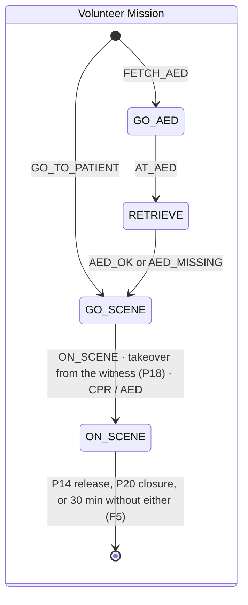
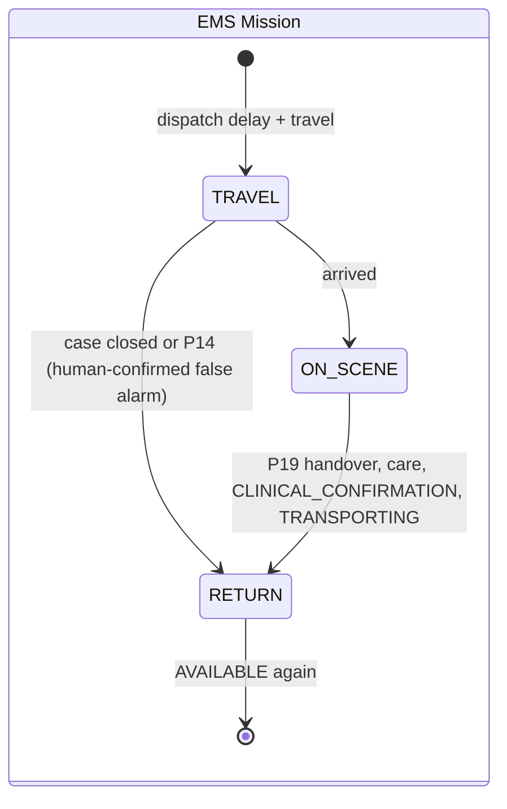
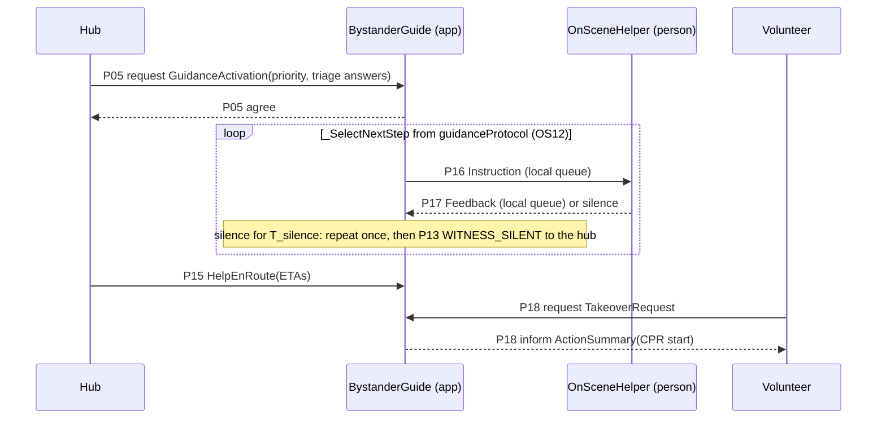

# Detailed Design — Agent Model, Services Model and SPADE Mapping

ISIA 2026/27 · Assignment 1 · Topic O · Gaia phase 3 of 3

This phase turns the roles and protocols of the architectural design
([02-architectural-design.md](02-architectural-design.md)) into concrete agent types and the services
they offer. It also records how those map onto SPADE, the decision logic inside the agents, the
behaviour models of the humans in the loop, and how each failure mode is handled. Message formats are
specified in [04-protocols-and-messages.md](04-protocols-and-messages.md).

## 1. Agent model

Gaia's agent model names the agent types, the roles each type plays and how many instances exist.
Instance counts are those of the base scenario C1 (analysis §8.3). Scenario files change them.

| Agent type (SPADE class) | Roles | Instances (C1) | Runs on |
|---|---|---|---|
| `AEDHubAgent` | IncidentVerifier (R3), IncidentCoordinator (R4), AEDCustodian (R7), ReputationManager (R11) | 1 per AED cabinet (10) | Connected AED cabinet, the hub of its cell |
| `CitizenDeviceAgent` | SensorMonitor (R1), PrivacyGuardian (R12) of the wearer | 40 | Wearable or phone |
| `BystanderAgent` | WitnessReporter (R2), BystanderGuide (R9), OnSceneHelper (R10), PrivacyGuardian (R12) of its own location | 15 | Citizen's phone |
| `VolunteerAgent` | VolunteerResponder (R5), AEDRunner (R6) | 30 | Volunteer's phone |
| `EMSAgent` | EMSUnit (R8) | 4 | Ambulance |

Each role is played by exactly one agent type. The analysis grouped roles by sub-organisation; the
grouping into agents follows **where the data lives**:

- **Hub roles share one agent** because they share the case record (`incidentCase`), the registry and
  the trust table. The verifier → coordinator hand-over (P06) then never crosses the network, which
  keeps ownership exclusive (OS1) without extra messages.
- **The PrivacyGuardian runs on the data subject's own device.** The data never leaves it unless
  disclosed (D7).
- **BystanderGuide and OnSceneHelper share the witness's phone**, so guidance keeps working without
  network (F13); P16/P17 stay local.
- **One VolunteerAgent plays R5 or R6** depending on the task awarded. A volunteer is the same person
  whatever the task, so OS2 (one commitment at a time) is a property of a single agent.

## 2. Inside a SPADE agent

### 2.1 Routing

SPADE delivers a message to **every** behaviour whose template matches it, and a behaviour without a
template matches everything. Each agent therefore has a single **Router** (`CyclicBehaviour`, no
template), and all other behaviours use a template that never matches. The router forwards:

1. **Service requests**, whatever the thread:
   - registrations (P25);
   - AED reservation, retrieval and release (P11, P12, P20 `AEDRelease`);
   - trust queries and reputation summaries (P22, P23);
   - candidate notices (P26);
   - heartbeats and case snapshots (P27);
   - disclosure requests (P24).
2. **Messages of an open conversation**, by `thread`, to that conversation's FSM.
3. **Everything else** to the agent's `on_message`: new alerts, calls for proposals, awards, guidance
   activations.

### 2.2 Behaviour types

These implement the liveness expressions (analysis §9.4):

| Liveness pattern | SPADE behaviour | In this code |
|---|---|---|
| `(x)^ω`, the agent's message loop | `CyclicBehaviour` | `Router`; `Sensing` (device); `Watching` (bystander) |
| Periodic activity | `PeriodicBehaviour` (`SimPeriodic`, period in simulated seconds) | `_DecayTrust`, `ShareReputation` (P23), heartbeat (P27), watching predecessors (D8) |
| One episode with waits | `OneShotBehaviour` (`Worker`) | Alert episode; evaluating a call; answering triage; the OnSceneHelper loop; fallback purge; AED restock |
| Multi-step protocol with states | `FSMBehaviour` (`Conversation`) | `CaseFSM` (hub), `Mission` (volunteer), `EMSMission` (ambulance), `Guidance` (bystander) |

**Lifecycle.**

- SPADE removes a behaviour from its agent when it finishes, so workers and conversations do not
  accumulate.
- Every state and worker catches its own exceptions and writes an `error` event.
- SPADE's `kill()` only takes effect between iterations, and our states loop inside one iteration.
  So `next_incoming` checks whether the agent stopped, and a stopped agent's `send_to` is silent.
  This is what makes a crashed hub stop acting at once (crash-stop, OS1).

### 2.3 Time

All periods, timeouts and deadlines are in **simulated seconds** and pass through `SimClock` (factor
10 by default; [spikes/README.md](../spikes/README.md)). A conversation waits with
`next_incoming(deadline)`, which converts the remaining simulated time into a real timeout.

A run is **valid** only if simulated time really advanced as intended. `run.py` flags any of these:

- the clock fell short of the duration;
- the machine was suspended (wall clock vs monotonic clock);
- the event loop stalled by more than 2 simulated seconds.

### 2.4 Case FSM (hub)

```mermaid
stateDiagram-v2
    [*] --> VERIFY: P01 opens a candidate (announced to neighbours, P26)
    VERIFY --> DISPATCH: p >= τ_declare(p) and OS4 holds (P06)
    VERIFY --> DISCARD: p < 0.03, W_max expired, or merged into an earlier candidate (P26)
    DISPATCH --> CLOSE: priority P3 (contact only), or retracted (P07)
    DISPATCH --> TRACK: awards sent (P09, P10)
    TRACK --> CLOSE: TRANSPORTING, false alarm (EMS or human-confirmed retraction), timeout
    CLOSE --> [*]: P20 to participants, AED release, P21 outcome labels
    DISCARD --> [*]: P20 to an active guide; weak negative labels for cancelled sources
```



| State | What it does |
|---|---|
| **VERIFY** | Announces the candidate (P26) and queries the neighbourhood (P03). Asks witnesses the triage questions (P04) and repeats unanswered ones (F5). Activates guidance as soon as a witness says the person does not respond (OL3). Fuses evidence after every message (§4.1). |
| **DISPATCH** | Logs P06 and replicates the case (P27). Asks the subject's guardian for the location (P24), again if there is no answer. Calls ambulances (P10) and volunteers in ring 1 (P08), widening to ring 2 if nobody bids. Reserves an AED (P11), awards (P09, P10) and tells the guide what help is coming (P15). |
| **TRACK** | Follows P13 statuses and refreshes each awardee's deadline from the ETA it reports. Asks for the location again while it is still unknown, e.g. when the answer after a takeover was lost. Flags awards past ETA + δ and re-recruits uncovered tasks (OL6). Releases responders still on the way once N_need are on scene (OL8). Answers the ambulance's ON_SCENE with the roster (volunteers, else the guide). Releases everyone when the EMS takes over (OL7). Retries the ambulance call with backoff while no unit is free. Resends unacknowledged releases (F5). |
| **CLOSE** | Sends `CaseClosure` to participants and guides, and twice to the data guardian (OS11). Releases the AED, sends the P21 outcome labels to the hub's ReputationManager, and tells the successor the case is closed. |

The same `CaseFSM.handle` processes a case message in every state. A late witness report after
declaration still updates the belief, and if a human cancellation makes the belief fall below 0.3,
the case is **retracted** (P07, §4.1).

### 2.5 Volunteer and ambulance missions





- **Interruptions.** A `Release` (P14) or `CaseClosure` (P20) ends a volunteer's mission in any state;
  the volunteer stops where it is.
- **Takeover.** A `Takeover` (P28) only changes whom the mission reports to.
- **Re-registration.** After a mission the volunteer re-registers (P25) if it ended up in another cell.

### 2.6 Bystander guidance (SO-AT)



- **Local exchange.** The guide and the helper exchange P16/P17 through local queues, so guidance
  works without coverage. The guide's feedback arrives in its FSM mailbox like any other message.
- **Starting point.** The guide starts at the step coherent with the triage answers it received, so
  questions already answered are not asked again.
- **Ending.** Guidance ends on P18 (a volunteer arrives), P19 (the EMS arrives with no volunteer on
  scene) or P20.
- **F11.** If the guide reports a silent witness on a P1 with nobody on scene yet, the hub asks for
  one more volunteer.

### 2.7 Failover (D8)

```mermaid
sequenceDiagram
    participant O as Owner hub
    participant S as Successor hub
    participant P as Participants
    loop every 5 s
        O->>S: P27 Heartbeat(open cases, lease)
        S-->>O: P27 HeartbeatAck
    end
    O->>S: P27 CaseSnapshot (after every relevant change; no location, no clinical data)
    Note over O: crash
    Note over S: no heartbeat for lease (15 s) + 1 heartbeat
    S->>P: P28 Takeover(new coordinator)
    S->>P: P24 RequestDisclosure (location again)
```

| Aspect | Design |
|---|---|
| Successor | The owner's lowest-id neighbour. If its acks stop, the owner moves to the next neighbour and re-sends its snapshots. |
| What fails | Hubs fail by **crash-stop** (fault injection). |
| Inter-hub links | Fixed infrastructure: latency but no loss or coverage gaps. So a missing heartbeat means a crash, not a partition, and two hubs never own the same case. |
| Out of scope | Partitions of the fixed network would need the owner to step down when its lease expires. This is a stated limitation. |
| Alerts to a dead hub | A source that gets no `AlertAck` within 10 s re-sends to the hub's successors (F6). |

## 3. Services model

Gaia's services model lists, per agent type, the services it offers: inputs, outputs, and the
conditions before and after. Pre/post-conditions refer to the resources of analysis §4 and to the
organisational rules.

### AEDHubAgent

| Service | Inputs | Outputs | Pre-condition | Post-condition |
|---|---|---|---|---|
| Open or join candidate | `AlertReport` | `AlertAck`; candidate; P26 notice | Alert of this cell (or of a dead neighbour's) | Merged into the open candidate of the same cell within 90 s, else a new candidate |
| Resolve duplicates | P26 notice | `CandidateMerge` to the keeper; alert relay | Overlapping candidate in an adjacent cell | The candidate opened first keeps ownership; the other forwards its alerts and discards |
| Corroborate | candidate | P03 queries, P04 questions | Candidate open | Evidence fused; every source counted once |
| Activate guidance | complete triage, not responding | P05 | Witness answered the triage (OL5) | Guide active on the witness's phone (OL3) |
| Declare | belief, sources | `case_declared`, P06 | `p ≥ τ_declare(p)` ∧ OS4 | One owner (OS1); evidence and weights audited (OS10) |
| Discard | belief, clock | `candidate_discarded` | `p < 0.03` ∨ `W_max` expired ∨ merged | No dispatch; an active guide is closed |
| Retract | human cancellation after declaration | P07; P14 to volunteers (and to the EMS) | Belief below 0.3 | Ambulance cancelled only for a human-confirmed false alarm (OS6) |
| Locate | subject | P24 request (repeated once) | Case declared, P1/P2 | Location set, or refusal logged |
| Dispatch | needs(p), registry, AED registry | P10, P08, P11, P09, P15 | Location known (for awards) | ≤ N_max awards; one commitment per awardee (OS2); AED reserved first (OS3) |
| Track | P13 statuses | roster, P14, new P08 calls | Case in TRACK | Re-recruitment on failure or delay (OL6); surplus released (OL8); release after EMS (OL7) |
| Close | outcome | P20, `AEDRelease`, P21 | Outcome known or timeout | Participants informed; guardian purges (OS11); one outcome label set (OL9) |
| Register | `Registration` | `RegistrationAck` | — | Reachable for P03/P08, without coordinates (D3) |
| Custody of own AED | P11, P12, P20 | agree/refuse, unlock code | Valid reservation and award token | ≤ 1 active reservation (OS3); single-use code; restock after use |
| Reputation | P21 labels, P23 summaries | trust values, P23 gossip | — | Unknown pseudonyms at the prior (OS13); decay towards it |
| Replicate / take over | own cases; P27 from predecessors | P27, P28 | Predecessor silent > lease + margin | Cases continue under one owner; location re-requested |

### CitizenDeviceAgent

| Service | Inputs | Outputs | Pre-condition | Post-condition |
|---|---|---|---|---|
| Detect | sensor event (perception) | event type, local confidence | — | Raw signals never leave the device |
| Alert | event, policy | P01 (pending / no_response), P02 | AlertFirst for P1-like signals, ConfirmFirst otherwise (adaptive) | Acknowledged by the cell's hub or, failing that, its successor (F6) |
| Summarise evidence | `CorroborationQuery` | `CorroborationReply` | — | Only a verdict and a confidence are sent |
| Disclose (guardian) | `DisclosureRequest` | `Disclosure` / refusal | Hub or EMS of an active case; P1/P2 or consent | Logged; purged on closure or after the fallback retention |

### BystanderAgent

| Service | Inputs | Outputs | Pre-condition | Post-condition |
|---|---|---|---|---|
| Report | collapse seen (perception) | P01 witness report | Chooses to report (`p_report`) | Re-registered in the scene's cell |
| Corroborate | `CorroborationQuery` | confirm / no_data | — | Confirms only its own cell and time window |
| Answer triage | `TriageQuestion` | `TriageAnswer` | At the scene (else `unknown`) | Silence counts as unknown |
| Guide | P05, P15, P18, P19 | P16 instructions, P13 WITNESS_SILENT, `ActionSummary` | At the scene, no other guidance active | Instructions only from `guidanceProtocol` (OS12) |
| Disclose own location | `DisclosureRequest` | `Disclosure` / refusal | At the scene; same policy | Logged; purged on closure or fallback |

### VolunteerAgent

| Service | Inputs | Outputs | Pre-condition | Post-condition |
|---|---|---|---|---|
| Bid | `CallForProposals` | `Proposal` with ETAs / refusal | Not committed; under A_max / K_max (OS8); accepts (`p_accept`) | Position not disclosed, only ETAs |
| Commit | `Award` | `AwardConfirmation` / failure | No other commitment (OS2) | Mission FSM started |
| Fetch AED | award with reservation and token | P12; AED_OK / AED_MISSING | Valid reservation for this case | AED carried to the scene, or the runner helps with CPR |
| Respond on scene | location, guide | P18, CPR, AED, P13, P19 summary | Arrived | Patient changed only on scene |

### EMSAgent

| Service | Inputs | Outputs | Pre-condition | Post-condition |
|---|---|---|---|---|
| Bid | `AmbulanceCall` | `AmbulanceProposal` / refusal | AVAILABLE | ETA includes the dispatch delay |
| Respond | `AmbulanceAward` | confirmation, P13, P19 | AVAILABLE | Clinical confirmation always reported (reference label) |
| Stand down | P14 (human-confirmed false alarm) | `ReleaseAck` | En route | Returns to base (OS6) |

## 4. Decision logic

All decision logic lives in pure modules under `src/cemr/behaviours/` and is unit-tested
(`tests/test_logic.py`, `tests/test_sprint2.py`).

### 4.1 Evidence fusion and priority (D5, `verification.py`)

`L = logit(prior) + Σ w(trust) · confidence · ln LR(evidence)`, with `w = min(2, trust / 0.5)`.

The table shows the calibration: each target, the sum of terms, and the resulting probability.

| Target | Terms | Result |
|---|---|---|
| P1 device alert + silent wearer → declare | logit(.15) + .8 ln 3 + ln 10 | p = .81 ≥ .60 |
| P2 device alert + silent wearer → declare | logit(.15) + .68 ln 3 + ln 10 | p = .79 ≥ .75 |
| Any device alert + "I'm fine" → discard | logit(.15) + .8 ln 3 + ln .05 | p = .02 < .03 |
| Witness report + "no response, not breathing" → declare | logit(.15) + .8 ln 6 + ln 10 | p = .88 ≥ .60 |
| P3 fall detected only by a sensor | logit(.15) + .45 ln 3 + ln 10 | p = .74 < .85: not dispatched (contact only) |

**Priority, with safety first.** Each active source supports a priority:

- a witness's **coherent** triage gives its own priority (P1: not responding and not breathing;
  P2: not responding but breathing; P3: responding);
- otherwise a source supports the provisional priority of its alert (`collapse_cardiac` → P1,
  `fall_immobile` → P2, `fall` → P3, witness report → P1).

The case takes the **most severe** of these.

- **Why not let the witness's triage win.** An early version did, and a witness's 10 % observation
  error turned a P1 detected by a cardiac sensor into a P3 that was never dispatched.
- **Incoherent triage.** "Responds" but "does not breathe normally" cannot both be true. Since
  observation errors are independent, the hub asks those two questions once more (F4). A second
  incoherent answer is ignored. Before this, a single witness's incoherent triage left OS4 unmet and
  the P1 was discarded when its window expired.
- **Retraction (P07).** A declared case whose belief falls below 0.3 after a human cancellation (the
  wearer's "I'm fine", or a witness retracting) is retracted. Volunteers are released, and so is the
  ambulance, because a human confirmed the false alarm (OS6).

### 4.2 Contract Net and re-allocation (D4, `contract_net.py`, `case_fsm.py`)

`score = ETA × (1 + 0.5 · [below the needed qualification]) / (trust / 0.5)`; lower is better.

1. **Awards.**
   - The FETCH_AED slot is filled first: the best bid whose AED can be reserved wins.
   - The GO_TO_PATIENT slots are then filled greedily, one task per bidder, at most N_max in total.
2. **Deadlines.** Each award has a deadline `arrive_by = ETA + δ` (δ = 120 s). It is refreshed
   whenever the volunteer reports EN_ROUTE with its own ETA for the current leg. In the first runs,
   leaving the deadline at the award-time estimate (made to the cell centre) flagged an AED runner as
   late 1.7 s before it arrived.
3. **OL6.** A failed award (WITHDRAWN, AED_MISSING, UNSAFE_SCENE, or P09 `failure`), or one past its
   deadline without arriving, no longer covers its task. The coordinator first awards from bids it
   already has, then calls ring 2. If an AED went missing, it is excluded from the next call.
4. **OL8.** When N_need(p) rescuers are on scene (P1: 2, P2: 1), awardees still on the way are
   released; an AED runner is released only once an AED has been delivered.
5. **Baseline B1** (`policy.allocation = "naive"`):
   - no verification: the case is declared on the first alert;
   - every volunteer up to ring 2 is called;
   - the first bidders to answer win;
   - no reputation.

ETAs are estimated to the **centre of the case's cell** because the precise location is only disclosed
with the award. Metric M9 (gap to the oracle B0) measures what this privacy costs.

### 4.3 Disclosure (D7, `privacy.py`)

| Field | Who may receive it | Legal basis |
|---|---|---|
| Precise location, building access | Hub (coordinator) or EMS of an active case | Consent, or vital interests in P1/P2 (GDPR art. 9(2)(c)) |
| Clinical data, identity | EMS of an active case only | Same |

- **Refusals.** Everyone else is refused with a reason, and every decision is logged.
- **Retention.** The guardian purges a case's data on `CaseClosure`, sent twice. If the closure never
  arrives, it purges after a fallback retention of 2 h (OS11, F5).

### 4.4 AED custody (OS3, `aed_custody.py`)

| From | Event | To |
|---|---|---|
| AVAILABLE | reserve | RESERVED |
| RESERVED | retrieve with reservation ref + award token | IN_USE |
| IN_USE | case closed | UNAVAILABLE until restocked (30 min) |
| UNAVAILABLE | restocked | AVAILABLE |
| RESERVED | expiry or cancel | AVAILABLE |

- **Faulty cabinet.** It fails at retrieval (F8).
- **Locked cabinet** (outside opening hours, C4). It stays UNAVAILABLE.
- **Several reservations.** A case never holds two at once: an old reservation is cancelled before
  another AED is reserved.

### 4.5 Reputation (D6, `reputation.py`)

**Labels (P21), written when the case closes:**

| Who | Success | Failure | Reference |
|---|---|---|---|
| Sources that supported the case | Real incident | False alarm | EMS clinical confirmation, or a human-confirmed false alarm |
| Responders | Arrived within ETA + δ | Failed, or late without arriving | — |

- **Discarded candidates.** A source that alerted and was then cancelled by a human gets a weak
  negative label (weight 0.5).
- **Gossip and decay.** Each hub sends its own counts to its neighbours every 10 min (P23). A
  neighbour's latest summary counts with discount 0.5, and recommendations are never re-shared, so
  they do not echo between hubs. All counts decay by 2 % every 10 min.
- **Use.** Trust weighs evidence (§4.1) and ranks bids (§4.2).

### 4.6 Guidance protocol (OS12, `guidance.py`)

`SCENE_SAFETY` → `CHECK_RESPONSE` → `CALL_112` (if nobody has) → `CHECK_BREATHING` → then:

- **not breathing:** `COMPRESSIONS` (two-minute cycles at 110/min, repeated until someone takes over);
- **breathing:** `RECOVERY_POSITION` → `KEEP_WATCHING`.

If breathing stops, the guide returns to compressions. Steps already answered in the triage are
skipped. The guide can only choose step ids from this table.

### 4.7 Failure modes (analysis §8.4) as implemented

| Failure | Detection | Handling | Where |
|---|---|---|---|
| F1 sensor false positive | wearer answers; corroboration | P02, OS4, reputation | `citizen_device`, `verification`, P21 |
| F2 false negative, person alone | — | third OS4 branch (automatic alert + silent wearer) | `verification.os4_branch` |
| F3 sensor drift | trust of the source falls | weight by trust; decay | `reputation`, C2 |
| F4 wrong or misread human report | incoherent triage; EMS finds nobody | re-ask once, then ignore; reputation; prior trust for new witnesses | `case_fsm.on_triage`, P21, C2 |
| F5 lost or late messages | deadlines | triage re-ask (12 s), P24 re-request (also during TRACK), P14 resend, idempotent ids, mission time cap, double closure | `case_fsm`, `volunteer` |
| F6 hub failure | heartbeats stop | successor takeover (P27/P28); sources fall back to the successor | `aed_hub`, `base.raise_alert`, C4 |
| F7 volunteer no-show or late | ETA + δ, WITHDRAWN | re-recruitment (OL6); release of surplus (OL8) | `case_fsm.check_progress` |
| F8 AED missing or locked | `AED_MISSING`, registry state | AED excluded; new FETCH call | `case_fsm`, `aed_custody` |
| F9 simultaneous incidents | — | one commitment per responder (OS2), one reservation per AED (OS3) | C3 |
| F10 ambulance late or unavailable | no proposals | retry with backoff (30 → 120 s); guided CPR continues | `case_fsm.award_ambulance` |
| F11 witness gives up | silence for T_silence | repeat, WITNESS_SILENT, one more volunteer on P1 | `bystander`, `case_fsm` |
| F12 personal-data leak | audit log | need-to-know policy; purge; rule check OS5/OS11 | `privacy`, `check.py` |
| F13 cell without network | — | local guidance; fallback hub; 112 remains (A7) | `bystander`, C4 |
| F14 duplicate case across borders | P26 notices | first opened keeps; relays alerts | `aed_hub` |
| F15 alert spam with fresh pseudonyms | — | prior trust (OS13); OS4 still needs evidence | (C5, optional) |

## 5. Behaviour models of the humans and the environment

Parameters are in `scenarios/defaults.toml`, with the analysis assumption they implement.

| Model | Behaviour |
|---|---|
| Wearer (A4) | A conscious wearer answers "Are you OK?" with p = 0.9 within 3–25 s; a P1/P2 patient never answers. |
| Witness (A5) | Reports with p = 0.8 after 20–60 s, standing 5–15 m from the patient. Answers each triage question with p = 0.95 and misreads the patient's state with p = 0.1 (0.2 in C2). In C2 some citizens also "see" a collapse that is not one (a sleeping person), and answer accordingly. |
| OnSceneHelper (A5) | Starts each instruction after 3–8 s. Gives up with p = 0.03 per instruction, plus 0.03 per compression cycle after the second (fatigue). Says it is tired from the third cycle. |
| Volunteer (A6) | Accepts a call with p = 0.7 after 3–8 s. An awardee fails to show with p = 0.05 (half withdraw on the way, half go silent). Real travel takes 0–30 % longer than estimated. |
| Sensors (A2) | Detect a real collapse with p = 0.9 after 10–20 s; 0.02 false positives per device per hour. In C2 there are ×5 false positives and 4 drifting devices with 1 per hour. |
| EMS | 240 s of call handling and activation, then 30 km/h. In C4 the stations are 1.5 km outside the area and activation takes 300 s. |

## 6. Environment as implemented

The `World` (`src/cemr/sim/world.py`) is simulation infrastructure, not an agent. Access goes through
methods that follow the environment–role matrix (analysis §5.4).

| Resource (analysis §4.1) | Implementation | Access |
|---|---|---|
| `roadNetwork` | `CityGrid`: 3 × 3 km, 100 m grid, Manhattan travel, Voronoi cells, neighbours, rings | Read by all |
| `simClock` | `SimClock` | Read by all |
| `sensorStream[d]` | Pre-generated sensor events, delivered to the device's perception queue | Only device `d` |
| `wearerResponse[d]` | `World.wearer_response(d)` | Only device `d` |
| `aedRegistry` | `World.aed_registry` | Read by all; an entry is changed only by its own hub |
| `patientCondition[c]` | `PatientState`; `observe_patient`, `act_start_cpr`, `act_attach_aed`, `act_ems_arrive` (within 30 m of the patient) | Only on scene |
| `groundTruth` | `gt_*` events in the log; the trace file | No agent |
| `auditLog` | `EventLog` (events.jsonl) | Append by all; read by metrics and the rule checker |
| `incidentCase`, `trustTable`, `responderState`, `emsState`, `subjectData` | Held inside the agent that owns them | Through protocols only |

**Network** (`NetworkModel`):

- log-normal latency (median 0.3 s);
- loss and per-cell outages on links that involve a phone;
- FIFO order per link;
- inter-hub links without loss or gaps;
- messages to or from a crashed agent are dropped (`agent_down`).

**Reproducibility (RNF9).**

- The layout and the whole stimulus trace (collapses, sensor events, witness observations, misread
  scenes, wearer responses, the C3 surge) are generated before the run from the seed. The trace hash
  is recorded, and the same seed gives the same hash.
- Agents draw from per-agent random streams.
- Message interleavings still depend on asyncio scheduling, so results are means over seeds.

## 7. Parameters and rules changed from the analysis

| Item | Analysis | Now | Why |
|---|---|---|---|
| `W_max` P1 / P2 | 30 s / 60 s | 45 s / 75 s | The wearer prompt lasts 30 s; the third OS4 branch could never complete in 30 s |
| Prior P(real \| candidate) | — | 0.15 | Calibrated so the targets in §4.1 hold |
| Likelihood ratios | — | `scenarios/defaults.toml` | The analysis fixed the method, not the numbers |
| Priority under conflicting evidence | not specified | most severe active source; incoherent triage ignored | Safety (RNF5); see §4.1 |
| Retraction threshold | not specified | belief < 0.3 after a human cancellation | P07 needs a trigger |
| N_need(p) | named, no value | P1: 2, P2: 1 | OL8 |
| Retries | "deadlines and repetition" | resend after 20 s, at most twice; triage deadline 12 s | F5; witnesses answer in 3–10 s, so a retry fits inside W_max(P1) |
| EMS response | — | 240 s + 30 km/h | ~6–9 min in C1; to be confirmed against a source (e.g. INEM data) |
| Enumerated values | Portuguese | English | They are code identifiers; the mapping is in 04 §5 |

Time metrics are computed over **detectable** incidents (a wearable or a witness was present).
An incident with neither can only be caught by a 112 call, which is not simulated (A7). It still
counts against recall.

## 8. How the design is checked

| Check | What it covers |
|---|---|
| Unit tests (`tests/test_logic.py`, `tests/test_sprint2.py`, 36 tests) | Fusion and OS4; the priority rule; Contract Net; disclosure; AED custody; reputation with gossip and decay; guidance steps; Larsen; network FIFO; trace reproducibility; payload round trips; the rule checker catching injected violations |
| End-to-end tests (`tests/test_end_to_end.py`) | C1: the OL1 sequence, OL2, OL7, OS5, zero rule violations, valid run. C4: the takeover of a crashed hub's case within 40 s, P28 reaching participants, the crashed hub silent, no orphaned cases |
| Rule checker (`python -m cemr.metrics.check runs/<run>`) | Re-derives OS1–OS6, OS8, OS9, OS11–OS13, OL1–OL3, OL5–OL7 and OL9 from the audit log after every run. It runs inside `run.py` and is reported in `summary.json` |
| Validity checks (`run.py`) | Discards runs in which the machine slept or the event loop stalled |

**OS9** (only a P3 commitment may be preempted, for a P1) holds vacuously: P3 cases get contact and
guidance but no ambulance (analysis §2.2), so there is nothing to preempt. The checker verifies that
no P3 case ever receives an ambulance.
