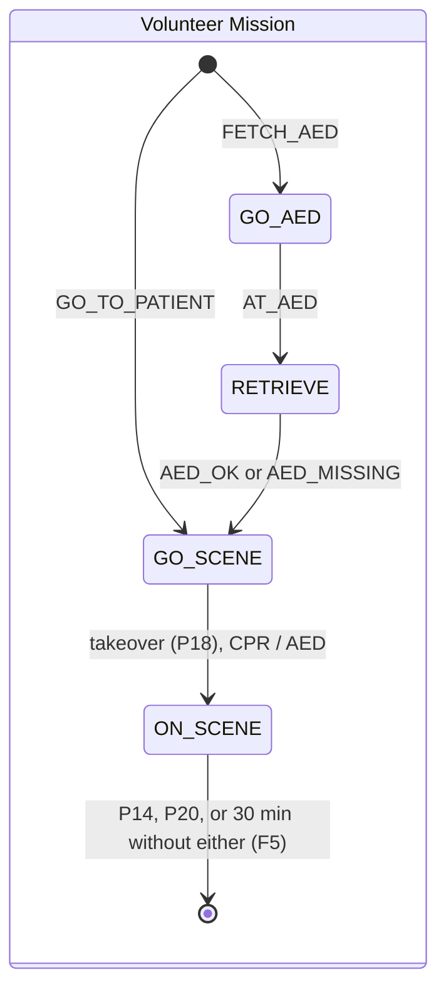
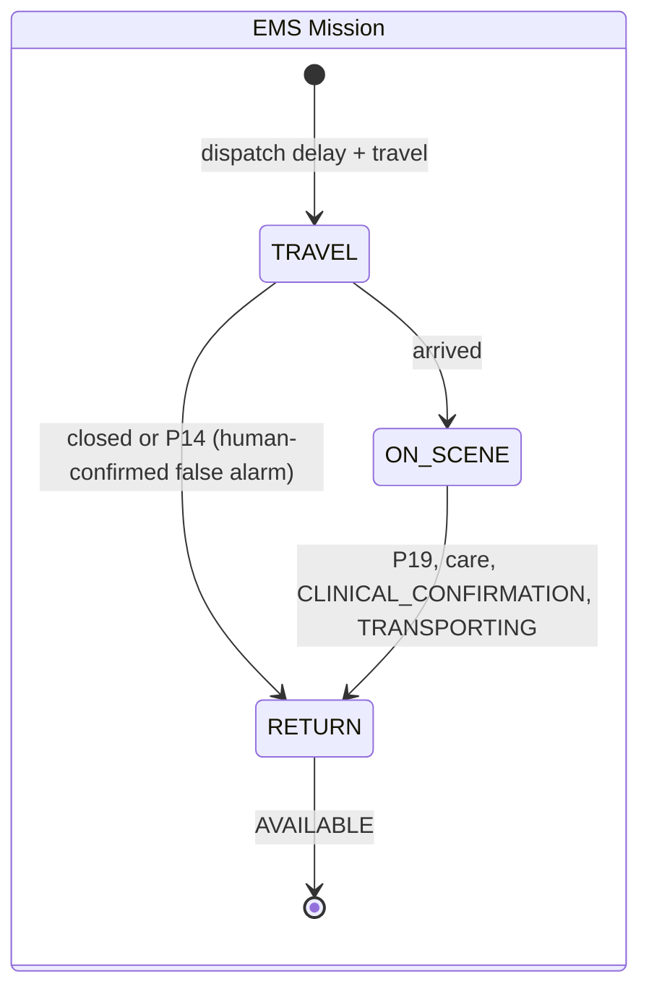
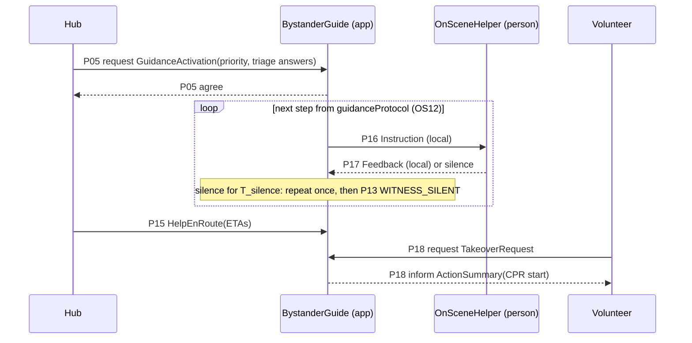
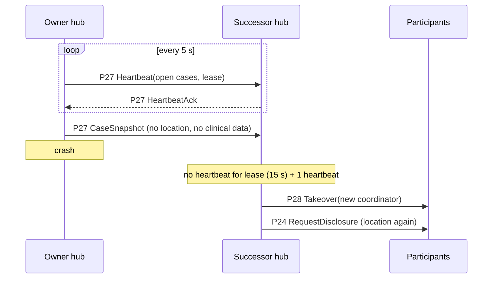

# Detailed Design

ISIA 2026/27 · Assignment 1 · Topic O · Gaia phase 3 of 3

This phase turns the roles and protocols of [02-architectural-design.md](02-architectural-design.md)
into agent types (agent model) and the services they offer (services model). It also records the SPADE
mapping, the decision logic, the human behaviour models and how each failure mode is handled. Message
formats are in [04-protocols-and-messages.md](04-protocols-and-messages.md).

## 1. Agent model

Instance counts are those of the base scenario C1 (analysis §8.3).

| Agent type | Roles | Instances (C1) | Runs on |
|---|---|---|---|
| `AEDHubAgent` | R3 IncidentVerifier, R4 IncidentCoordinator, R7 AEDCustodian, R11 ReputationManager | 10 | AED cabinet, hub of its cell |
| `CitizenDeviceAgent` | R1 SensorMonitor, R12 PrivacyGuardian of the wearer | 40 | Wearable or phone |
| `BystanderAgent` | R2 WitnessReporter, R9 BystanderGuide, R10 OnSceneHelper, R12 of its own location | 15 | Citizen's phone |
| `VolunteerAgent` | R5 VolunteerResponder, R6 AEDRunner | 30 | Volunteer's phone |
| `EMSAgent` | R8 EMSUnit | 4 | Ambulance |

Roles are grouped by where their data lives. The hub roles share the case record, the registry and
the trust table, so the P06 hand-over never crosses the network and ownership stays exclusive (OS1).
The PrivacyGuardian runs on the data subject's own device. The guide and the helper share the
witness's phone, so guidance works without network. One volunteer agent plays R5 or R6, so OS2 is a
property of a single agent.

Code in `src/cemr/agents/`, one module per agent type, larger ones split by role or state:

| Agent type | Modules |
|---|---|
| all | `base.py` (routing, send path, P01 with fallback, P25), `conversation.py` (router, workers, periodic behaviours, conversation FSMs) |
| `AEDHubAgent` | `aed_hub.py` (service handlers, P01 merging, P26), `hub_failover.py` (P27/P28), `case_*.py` (§2.4) |
| `CitizenDeviceAgent` | `citizen_device.py` |
| `BystanderAgent` | `bystander.py`, `bystander_guide.py` |
| `VolunteerAgent` | `volunteer.py` (bidding, OS2, OS8), `volunteer_mission.py` |
| `EMSAgent` | `ems.py` |

## 2. Inside a SPADE agent

### 2.1 Routing

SPADE delivers a message to every behaviour whose template matches, so each agent has a single
`Router` (`CyclicBehaviour`, no template) and no other behaviour matches anything directly. The router
sends service requests (P11, P12, P20 `AEDRelease`, P23–P27) to their handler, messages of an open
conversation to that conversation's FSM by `thread`, and everything else (new alerts, calls, awards,
guidance activations) to the agent's `on_message`. P22 has no messages: the coordinator reads its own
hub's trust table.

### 2.2 Behaviour types

The behaviours implement the liveness expressions of the analysis:

| Liveness pattern | SPADE behaviour | In this code |
|---|---|---|
| `(x)^ω`, the message loop | `CyclicBehaviour` | `Router`; `Sensing` (device); `Watching` (bystander) |
| Periodic activity | `PeriodicBehaviour` (`SimPeriodic`, period in simulated seconds) | trust decay, P23 gossip, P27 heartbeat, watching predecessors |
| One episode with waits | `OneShotBehaviour` (`Worker`) | alert episode, evaluating a call, answering triage, the helper loop |
| Multi-step protocol | `FSMBehaviour` (`Conversation`) | `CaseFSM` (hub), `Mission` (volunteer), `EMSMission`, `Guidance` (bystander) |

Finished behaviours are removed by SPADE, so they do not accumulate. Each state catches its own
exceptions and logs an `error` event. Because `kill()` only acts between iterations, `next_incoming`
checks whether the agent stopped and a stopped agent sends nothing: a crashed hub stops acting at once.

### 2.3 Time

All periods and deadlines are in simulated seconds and go through `SimClock` (10× by default). A
conversation waits with `next_incoming(deadline)`, which converts simulated into real time. `run.py`
marks a run invalid if the clock fell short, the machine was suspended or the event loop stalled for
more than 2 simulated seconds.

### 2.4 Case FSM (hub)

```mermaid
stateDiagram-v2
    [*] --> VERIFY: P01 opens a candidate (P26 to neighbours)
    VERIFY --> DISPATCH: p >= τ_declare(p) and OS4 holds (P06)
    VERIFY --> DISCARD: p < 0.03, W_max expired, or merged (P26)
    DISPATCH --> CLOSE: P3 (contact only), or retracted (P07)
    DISPATCH --> TRACK: awards sent (P09, P10)
    TRACK --> CLOSE: TRANSPORTING, false alarm, timeout
    CLOSE --> [*]: P20, AED release, P21 labels
    DISCARD --> [*]: P20 to an active guide; weak negative labels
```

| State | What it does |
|---|---|
| VERIFY | P26 to neighbours, P03 to the neighbourhood, P04 to witnesses (unanswered questions re-asked, F5). P05 as soon as a witness says the person does not respond (OL3). Fuses evidence after every message (§4.1) |
| DISPATCH | Logs P06, replicates (P27), asks the guardian for the location (P24, repeated once). Calls ambulances (P10) and volunteers (P08, widened to ring 2), reserves an AED (P11), awards (P09, P10), tells the guide what help is coming (P15) |
| TRACK | Follows P13; refreshes deadlines from reported ETAs; re-recruits uncovered or late tasks (OL6); releases the surplus (OL8); answers the ambulance's ON_SCENE with the roster; releases everyone after the EMS takes over (OL7); retries the ambulance call with backoff; resends unacknowledged releases (F5) |
| CLOSE | `CaseClosure` to participants and twice to the data guardian (OS11), AED release, P21 labels, closure to the successor |

A late witness report still updates the belief, and a human cancellation that drops it below 0.3
retracts the case (P07). Modules: `case_record.py` (record and P27 snapshot), `case_fsm.py` (states and
message dispatch), `case_verify.py` (VERIFY, DISCARD), `case_dispatch.py`, `case_awards.py` (Contract Net
with volunteers), `case_track.py`, `case_close.py`.

### 2.5 Volunteer and ambulance missions

P14 or P20 ends a volunteer's mission in any state. P28 only changes whom the mission reports to. After
a mission the volunteer re-registers (P25) if it is now in another cell.

### 2.6 Bystander guidance (SO-AT)

P16/P17 go through local queues, so guidance works without coverage. The guide starts at the step that
matches the triage answers it received and ends on P18, P19 or P20. A silent witness on a P1 with nobody
on scene makes the hub ask for one more volunteer (F11).

### 2.7 Failover (D8)

If the successor's acks stop, the owner moves to its next neighbour and re-sends its snapshots. The
failure model (crash-stop, lossless inter-hub links) is described in 02 §D8.

## 3. Services model

Pre- and post-conditions refer to the resources and rules of the analysis.

| Agent | Service | Inputs → outputs | Pre-condition | Post-condition |
|---|---|---|---|---|
| Hub | Open or join candidate | `AlertReport` → `AlertAck`, P26 notice | Alert of this cell or of a dead neighbour's | Merged into a candidate opened within 90 s whose area is ≤ 100 m away, else a new one |
| Hub | Resolve duplicates | P26 notice → `CandidateMerge` or own notice | Same incident | First opened keeps the case; the other forwards its alerts |
| Hub | Corroborate | candidate → P03, P04 | Candidate open | Each source counted once; confirmations from another area ignored |
| Hub | Activate guidance | triage "not responding" → P05 | Witness answered the triage (OL5) | Guide active (OL3) |
| Hub | Declare / discard / retract | belief → P06 / discard / P07 | `p ≥ τ_declare(p)` ∧ OS4 / `p < 0.03` ∨ `W_max` / belief < 0.3 after a human cancellation | One owner (OS1), audited (OS10); ambulance cancelled only on a human-confirmed false alarm (OS6) |
| Hub | Locate | subject → P24 | P1/P2 declared | Location set or refusal logged |
| Hub | Dispatch and track | needs(p) → P10, P08, P11, P09, P15, P14 | Location known for awards | ≤ N_max awards, OS2, OS3; OL6, OL7, OL8 |
| Hub | Close | outcome → P20, `AEDRelease`, P21 | Outcome known or timeout | Guardian purges (OS11); one label set (OL9) |
| Hub | Register, custody, reputation, failover | P25, P11/P12, P21/P23, P27 | — | No coordinates kept (D3); ≤ 1 reservation per AED; new pseudonyms at the prior (OS13); one owner after takeover |
| Device | Detect and alert | sensor event → P01, P02 | AlertFirst for P1-like signals, else ConfirmFirst | Raw signals never leave the device; acknowledged by the hub or its successor (F6) |
| Device | Corroborate | `CorroborationQuery` → reply | — | Only verdict, confidence and area (~100 m) |
| Device, bystander | Disclose (guardian) | `DisclosureRequest` → `Disclosure` / refusal | Hub or EMS of an active case; P1/P2 or consent | Logged; purged on closure or after the fallback retention |
| Bystander | Report, answer triage | collapse seen → P01; `TriageQuestion` → answer | Chooses to report (`p_report`); at the scene | Silence counts as unknown |
| Bystander | Guide | P05, P15, P18, P19 → P16, P13, `ActionSummary` | At the scene | Instructions only from `guidanceProtocol` (OS12) |
| Volunteer | Bid and commit | `CallForProposals` → `Proposal`; `Award` → confirmation / failure | Not committed, under A_max / K_max (OS8) | Only ETAs leave the phone; one commitment (OS2) |
| Volunteer | Fetch AED, respond | award → P12, P18, P13, P19 | Valid reservation; arrived | AED delivered or runner helps with CPR |
| EMS | Bid, respond, stand down | `AmbulanceCall` → proposal; award → P13, P19; P14 → ack | AVAILABLE; en route for P14 | Clinical confirmation always reported (reference label) |

## 4. Decision logic

The decision logic lives in pure modules under `src/cemr/behaviours/`, unit-tested without SPADE. The
agents' states call these functions and only send messages and log events.

### 4.1 Evidence fusion and priority (D5, `verification.py`)

`L = logit(prior) + Σ w(trust) · confidence · ln LR(evidence)`, with `w = min(2, trust / 0.5)`. With
`w = confidence = 1` this is the naive Bayes update; the trust weight is a heuristic, not an exact
Bayesian update. Calibration with prior 0.15:

| Target | Terms | Result |
|---|---|---|
| P1 device alert + silent wearer → declare | logit(.15) + .8 ln 3 + ln 10 | p = .81 ≥ .60 |
| P2 device alert + silent wearer → declare | logit(.15) + .68 ln 3 + ln 10 | p = .79 ≥ .75 |
| Any device alert + "I'm fine" → discard | logit(.15) + .8 ln 3 + ln .05 | p = .02 < .03 |
| Witness report + "no response, not breathing" → declare | logit(.15) + .8 ln 6 + ln 10 | p = .88 ≥ .60 |
| P3 fall detected only by a sensor | logit(.15) + .45 ln 3 + ln 10 | p = .74 < .85, contact only |

Each active source supports a priority: a witness's coherent triage gives its own (P1 not responding
and not breathing, P2 not responding but breathing, P3 responding); otherwise the provisional priority
of its alert (`collapse_cardiac` P1, `fall_immobile` P2, `fall` P3, witness report P1). The case takes
the most severe one (§9.3). Three refinements came from runs:

- an incoherent triage ("responds" but "does not breathe normally") is asked again once, and ignored if
  still incoherent;
- a triage that contradicts the witness's own report ("responds" after reporting a collapse) is asked
  again once (`triage_contradicts_report`); before this, a lone witness's case dropped to P3, could not
  reach τ(P3) = 0.85 and was discarded (§7.1);
- a source adds its alert evidence once per candidate, however many alerts it sends.

A declared case whose belief falls below 0.3 after a human cancellation is retracted (P07), and the
ambulance is released because a human confirmed the false alarm (OS6).

### 4.2 Contract Net and re-allocation (D4, `contract_net.py`, `case_awards.py`)

`score = ETA × (1 + 0.5 · [below needed qualification]) / (trust / 0.5)`, lower is better. The
FETCH_AED slot is filled first (best bid whose AED can be reserved), then the GO_TO_PATIENT slots
greedily, one task per bidder, at most N_max. Each award has a deadline `ETA + δ` (δ = 120 s), refreshed
when the volunteer reports EN_ROUTE. A failed award (WITHDRAWN, AED_MISSING, UNSAFE_SCENE, P09
`failure`) or one past its deadline is re-awarded from existing bids, then by a ring-2 call; a missing
AED is excluded (OL6). When N_need(p) rescuers are on scene (P1: 2, P2: 1) the others are released, an
AED runner only after an AED arrived (OL8). Baseline B1 (`policy.allocation = "naive"`) declares on the
first alert, calls every volunteer up to ring 2, awards the first bidders and uses no reputation.

ETAs are estimated to the centre of the case's cell, because the precise location only comes with the
award. Metric M9 (gap to the oracle B0) measured from the declaration therefore contains this privacy
cost, the greedy award, refusals and the proposal deadline; it bounds them from above without
separating them. B0 ignores refusals and busy volunteers, so it is optimistic.

### 4.3 Disclosure (D7, `privacy.py`)

| Field | Who may receive it | Legal basis |
|---|---|---|
| Precise location, building access | Coordinator or EMS of an active case | Consent, or vital interests in P1/P2 (GDPR art. 9(2)(c)) |
| Clinical data, identity | EMS of an active case only | Same |

Everyone else is refused and every decision is logged. The guardian purges a case's data on
`CaseClosure` (sent twice) or, failing that, after 2 h (OS11, F5).

### 4.4 AED custody (OS3, `aed_custody.py`)

AVAILABLE → RESERVED on reservation; RESERVED → IN_USE on retrieval with reservation ref and award
token; RESERVED → AVAILABLE on expiry or cancel; IN_USE → UNAVAILABLE on closure, back to AVAILABLE
after a 30 min restock. A faulty cabinet fails at retrieval (F8); a locked one (C4, outside opening
hours) stays UNAVAILABLE. A case cancels its old reservation before reserving another AED.

### 4.5 Reputation (D6, `reputation.py`)

At closure (P21), sources that supported the case get success if the incident was real and failure if
it was a false alarm (EMS confirmation or human-confirmed false alarm as reference). Responders get
success if they arrived within ETA + δ. A source cancelled by a human on a discarded candidate gets a
weak negative label (weight 0.5). Each hub sends its own counts to its neighbours every 10 min (P23);
a neighbour's latest summary counts with discount 0.5 and is never re-shared. Counts decay by 2 % every
10 min. Trust weighs evidence (§4.1) and ranks bids (§4.2).

### 4.6 Guidance protocol (OS12, `guidance.py`)

`SCENE_SAFETY` → `CHECK_RESPONSE` → `CALL_112` (if nobody has) → `CHECK_BREATHING`, then
`COMPRESSIONS` in two-minute cycles at 110/min if not breathing, or `RECOVERY_POSITION` →
`KEEP_WATCHING` if breathing (back to compressions if breathing stops). Steps already answered in the
triage are skipped; the guide can only choose steps from this list.

### 4.7 Failure modes as implemented

| Failure | Detection | Handling | Where |
|---|---|---|---|
| F1 sensor false positive | wearer answers; corroboration | P02, OS4, reputation | `citizen_device`, `verification` |
| F2 false negative, person alone | — | third OS4 branch (automatic alert + silent wearer) | `verification.os4_branch` |
| F3 sensor drift | trust of the source falls | trust weight, decay | `reputation`, C2 |
| F4 wrong or misread human report | incoherent or contradicting triage; EMS finds nobody | re-ask once; reputation; prior trust | `case_verify.recheck_triage`, C2 |
| F5 lost or late messages | deadlines | re-ask triage (12 s), re-request P24, resend P14, idempotent ids, double closure. Not handled: P05 guidance activation is sent once and not resent (known gap, see the report's limitations) | `case_verify`, `case_track`, `volunteer_mission` |
| F6 hub failure | heartbeats stop | successor takeover (P27/P28); sources fall back to the successor | `hub_failover`, `base.raise_alert`, C4 |
| F7 volunteer no-show or late | ETA + δ, WITHDRAWN | re-recruitment (OL6), surplus release (OL8) | `case_track.check_progress` |
| F8 AED missing or locked | `AED_MISSING`, registry state | AED excluded, new FETCH call | `case_awards`, `aed_custody` |
| F9 simultaneous incidents | — | OS2, OS3, calls in priority order | C3 |
| F10 ambulance late or unavailable | no proposals | retry with backoff (30 → 120 s); guided CPR continues | `case_dispatch.award_ambulance` |
| F11 witness gives up | silence for T_silence | repeat, WITNESS_SILENT, one more volunteer on P1 | `bystander_guide`, `case_track` |
| F12 personal-data leak | audit log | need-to-know policy, purge, rule check OS5/OS11 | `privacy`, `rules_safety` |
| F13 cell without network | — | local guidance; fallback hub; 112 remains (A7) | `bystander`, C4 |
| F14 duplicate case across borders | P26 notices | first opened keeps; older hub answers; rule DUP | `verification.notice_decision` |
| F15 alert spam with fresh pseudonyms | EMS finds nobody | prior trust (OS13); OS4; repeat offenders lose trust | `reputation`, C5 |

## 5. Behaviour models of the humans and the environment

Parameters are in `scenarios/defaults.toml`, next to the analysis assumption they implement.

| Model | Behaviour |
|---|---|
| Wearer (A4) | A conscious wearer answers "Are you OK?" with p = 0.9 within 3–25 s; a P1/P2 patient never answers |
| Witness (A5) | Reports with p = 0.8 after 20–60 s. Answers each triage question with p = 0.95 and misreads the patient with p = 0.1 (0.2 in C2). In C2 some citizens report a scene that is not a collapse; in C5 two pranksters report such scenes about 4 times per hour each |
| OnSceneHelper (A5) | Starts each instruction after 3–8 s; gives up with p = 0.03 per instruction, plus 0.03 per compression cycle after the second |
| Volunteer (A6) | Accepts a call with p = 0.7 after 3–8 s; fails to show with p = 0.05; real travel 0–30 % slower than estimated |
| Sensors (A2) | Detect a collapse with p = 0.9 after 10–20 s; 0.02 false positives per device-hour. C2: ×5, plus 4 drifting devices with 3 per hour, half never answered by the wearer |
| EMS | 240 s of activation, then 30 km/h (an assumption, see §7). C4: stations 1.5 km outside the area and 300 s activation |

## 6. Environment as implemented

The `World` (`src/cemr/sim/world.py`) is simulation infrastructure, not an agent. Access follows the
environment–role matrix of the analysis (§5.4).

| Resource | Implementation | Access |
|---|---|---|
| `roadNetwork` | `CityGrid`: 3 × 3 km, 100 m grid, Manhattan travel, Voronoi cells, rings | All |
| `simClock` | `SimClock` | All |
| `sensorStream[d]`, `wearerResponse[d]` | Pre-generated events; `World.wearer_response(d)` | Only device `d` |
| `aedRegistry` | `World.aed_registry` | Read by all, changed only by its hub |
| `patientCondition[c]` | `PatientState`; `observe_patient`, `act_start_cpr`, `act_attach_aed`, `act_ems_arrive` | Only within 30 m |
| `groundTruth` | `gt_*` events and the trace file | No agent |
| `auditLog` | `EventLog` (`events.jsonl`) | Append by all; read by metrics and checker |
| `incidentCase`, `trustTable`, `responderState`, `emsState`, `subjectData` | Inside the owning agent | Through protocols |

The `NetworkModel` adds log-normal latency (median 0.3 s), loss and per-cell outages on links that
involve a phone, keeps FIFO order per link, and drops messages to or from a crashed agent; inter-hub
links have no loss. The layout and the whole stimulus trace are generated from the seed before the run
(the trace hash is recorded), and agents draw from per-agent random streams. Message interleavings
still depend on asyncio scheduling, so results are means over seeds.

## 7. Parameters and rules changed from the analysis

| Item | Analysis | Now | Why |
|---|---|---|---|
| `W_max` P1 / P2 | 30 s / 60 s | 45 s / 75 s | The 30 s wearer prompt left no time for the third OS4 branch |
| Prior, likelihood ratios | method only | 0.15; `defaults.toml` | Calibrated so the targets of §4.1 hold |
| Priority under conflict | not specified | most severe source; contradicting triage re-asked once | Safety (§4.1, §9.3) |
| Retraction | not specified | belief < 0.3 after a human cancellation | P07 needs a trigger |
| Alert merging | same candidate | same cell, within 90 s, areas ≤ 100 m apart | Merging by cell fused patients in C3 (§7.1) |
| N_need(p) | named | P1: 2, P2: 1 | OL8 |
| Retries | "deadlines and repetition" | resend after 20 s, at most twice; triage deadline 12 s | F5, fits inside W_max(P1) |
| EMS response | — | 240 s + 30 km/h | ~6–9 min in C1; we found no source for Portuguese urban times |
| Drifting sensors (C2) | "some sensors with drift" | 3 per hour, half unanswered | With fewer, the same device repeated too rarely for reputation to act in 60 min |
| Robustness M12 | degradation with message loss | C1 with 10 % and 20 % loss, plus recovery after the C4 crash | Recovery alone is fixed by the lease |

Time metrics cover **detectable** incidents (a wearable or a witness present); the others can only be
caught by a 112 call, which is not simulated (A7), and still count against recall.

**Why a P1/P2 was missed** (`src/cemr/metrics/misses.py`). After each run, each P1/P2 without a declared
case at the patient gets the furthest point its alerts reached in the event log, P26 merges included.
`experiments/analyse.py` sums the reasons in `results/misses.md`.

| Reason | Meaning |
|---|---|
| `undetectable` | No wearable and no witness |
| `not_reported` | No source sent an alert |
| `alert_lost` | An alert was sent but no hub opened or joined a candidate with it |
| `discarded_low_belief` | Belief fell below the discard threshold |
| `discarded_as_p3` | `W_max` expired with the candidate at P3, whose threshold is the highest |
| `discarded_window` | `W_max` expired without reaching the threshold or meeting OS4 |
| `undecided_at_end` | The run ended during verification |
| `declared_p3` | Declared as P3: contact only |
| `retracted` | Retracted (P07) before the location arrived |
| `not_located` | Declared P1/P2 but the location (P24) never arrived |
| `other_incident` | Declared and located, but at another patient (two patients fused into one case) |

### 7.1 Design changes driven by the experiments

Three changes came from reading earlier matrices. Each is measured on the same seeds before and after,
for the variant "ours" (`experiments/evolution.py`, `results/evolution.md`). More than one change may lie
between two commits, so a row shows the effect of everything in between.

| Change | Scenario, metric | Before | After | After − before | Seeds |
|---|---|---|---|---|---|
| Alerts merged by a 100 m area instead of by cell | C3, M2 recall, detectable (%) | 64.0 ± 22.2 at `6df23fb` | 77.5 ± 13.7 at `67a012b` | +13.5 ± 13.3 | 1–5 |
| Triage that contradicts the report is asked again | C3, M2 recall, detectable (%) | 75.8 ± 8.2 at `67a012b` | 80.3 ± 10.8 at `de13290` | +4.5 ± 4.2 | 1–10 |
| Triage that contradicts the report is asked again | C3, M2 recall, reported (%) | 90.9 ± 5.8 at `67a012b` | 95.7 ± 5.2 at `de13290` | +4.8 ± 4.4 | 1–10 |
| A source counts once per candidate | C5, M2 false dispatches (per run) | 3.0 ± 0.7 at `67a012b` | 3.0 ± 0.7 at `de13290` | +0.0 ± 0.0 | 1–10 |
| A source counts once per candidate | C5, M2 precision (%) | 26.6 ± 14.0 at `67a012b` | 28.3 ± 15.0 at `de13290` | +1.7 ± 3.8 | 1–10 |

Merging by cell put two patients of the same cell into one case. Between `6df23fb` and `67a012b` the P26
answer also became symmetric, so part of the gain may come from that. Re-asking a contradicting triage
removed the C3 misses `discarded_as_p3` (3 to 0) and `discarded_window` (1 to 0) over seeds 1–10; the
`67a012b` event logs are not in git, so this count can only be repeated where they were kept. Counting a
source once had no effect in C5, because every false dispatch there comes from a prankster witness who
sends one report per incident. It stays because it is the correct fusion of independent evidence, not
because of a measured gain.

## 8. How the design is checked

| Check | What it covers |
|---|---|
| Unit tests (`pytest -m "not slow"`, 95 tests) | Fusion, OS4 and the priority rule; alert merging and P26; Contract Net, OL6 and OL8; disclosure; AED custody; reputation; guidance; network FIFO; trace reproducibility; payloads, the FIPA envelope and `not-understood`; the metrics; the rule checker on injected violations |
| End-to-end tests (`tests/test_end_to_end.py`) | C1: OL1, OL2, OL7, OS5, no rule violations, valid run. C4: takeover of a crashed hub's case within 40 s, no orphaned cases |
| Rule checker (`python -m cemr.metrics.check runs/<run>`) | OS1–OS6, OS8, OS9, OS11–OS13, OL1–OL3, OL5–OL7, OL9 and DUP from the audit log, after every run |
| Validity and version (`run.py`, `run_matrix.py`, `analyse.py`) | Runs where the machine slept are discarded; every summary records the commit and the analysis refuses mixed commits |

OS9 holds vacuously: P3 cases get no ambulance, so nothing is preempted. The checker verifies that no
P3 case receives one.

## 9. Positioning against the course concepts

### 9.1 Agent types and architectures

| Agent | Type (Russell and Norvig, 2022) | Why |
|---|---|---|
| `CitizenDeviceAgent` | Model-based reflex | Small state (`recent_alerts`), fixed rules |
| `VolunteerAgent` | Utility-based | Picks the AED and ETA that minimise arrival; accepting is a stochastic human model |
| `EMSAgent` | Utility-based | Bids its ETA |
| `AEDHubAgent` | Hybrid, layered (Wooldridge, 2009) | Reactive layer (router, AED custody, heartbeats) and deliberative layer (one FSM per case, fusion, Contract Net) |
| `BystanderAgent` | Human model plus guidance app | Fatigue and giving up override the current instruction, like a higher layer in a subsumption architecture |

The environment is partially observable, stochastic, dynamic, sequential, continuous and multi-agent.
The hub could be read as BDI: beliefs are the fused belief and the trust table, desires the open
candidates, intentions the awarded commitments, kept until achieved or believed impossible
(single-minded commitment). We kept plain SPADE behaviours because every protocol deadline stays
explicit and testable, and every decision is an event that the rule checker can re-read.

### 9.2 The Contract Net as an auction

The volunteer Contract Net is a reverse sealed-bid auction with a scoring rule: the bid is the ETA,
the score divides it by trust and the lowest wins (`contract_net.offer_score`). It is not a Vickrey
auction, because a second-price rule needs payments and there are none. Truthful bidding is encouraged
ex post by reputation (late arrival past ETA + δ gives a negative label), so a volunteer could
under-declare by up to δ = 120 s at no cost; the ETA is computed by the app, which softens this. Widening
to ring 2 and OL6 open new rounds with new participants, which is not the FIPA Iterated Contract Net.
Winner determination is greedy, while volunteer-plus-AED bundles make the optimum combinatorial; M9
bounds the cost (§4.2). The ambulance call is a first-price rule on ETA, again without payments.

### 9.3 Aggregating priorities

`case_priority` uses a **maximum severity** rule: the case takes the most severe priority that any
active source supports. With three sources at P3 and one at P1:

| Rule | Result |
|---|---|
| Plurality | P3 |
| Borda (2, 1, 0 points by distance to each source's priority) | P3 (6 against 4 for P2 and 2 for P1) |
| Condorcet winner | P3 (beats P2 and P1 three to one) |
| Ours (maximum severity) | P1 |

The rule keeps unanimity and anonymity but breaks the majority criterion and the Condorcet winner, and
a single source can raise the priority. OS4 and reputation limit that manipulation (C5). We accept it
for safety: treating a P1 as P3 costs far more than the opposite, and an early version that let the
witness's triage decide lost a P1 detected by a cardiac sensor. A witness's triage may still lower its
own report after being asked twice (§4.1). The sources give evidence about one patient, not preferences,
so this is a decision under asymmetric costs; the comparison shows what a majority rule would have done.

## References

- Jøsang, A., & Ismail, R. (2002). The Beta Reputation System. *15th Bled Electronic Commerce Conference*.
- Russell, S., & Norvig, P. (2022). *Artificial Intelligence: A Modern Approach* (4th ed.). Pearson.
- Shoham, Y., & Leyton-Brown, K. (2008). *Multiagent Systems: Algorithmic, Game-Theoretic, and Logical
  Foundations*. Cambridge University Press.
- Smith, R. G. (1980). The Contract Net Protocol. *IEEE Transactions on Computers*, C-29(12), 1104–1113.
- Wooldridge, M. (2009). *An Introduction to MultiAgent Systems* (2nd ed.). Wiley.
- FIPA (2002). *FIPA Contract Net Interaction Protocol Specification* (SC00029H).
