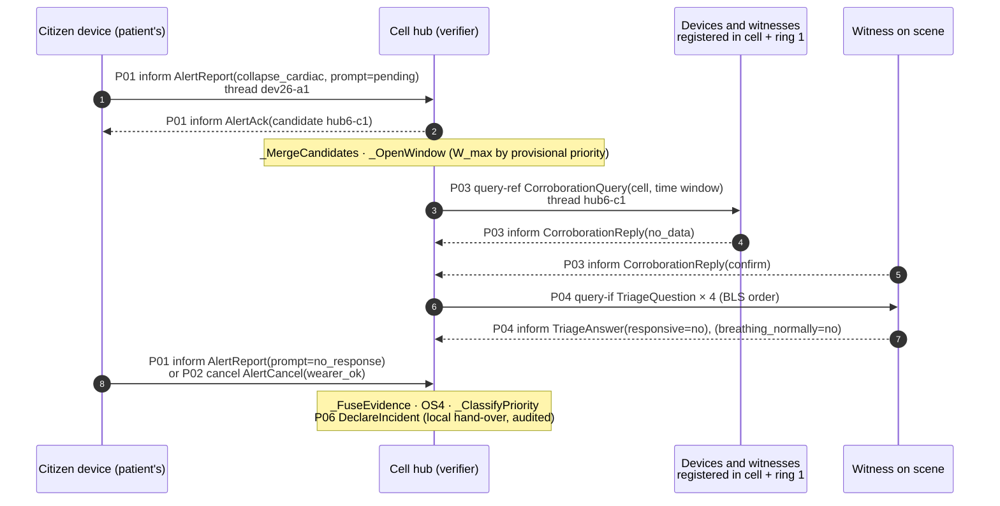
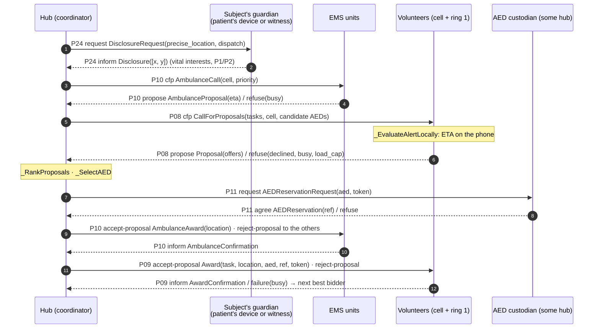
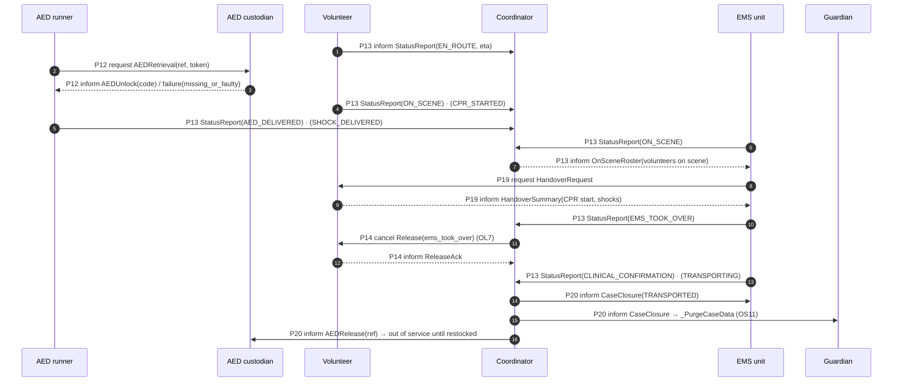

# Protocols and Message Schemas

ISIA 2026/27 · Assignment 1 · Topic O

This document fixes how the interaction model is realised:

- the message envelope;
- the conversation threads;
- the main conversations as sequence diagrams;
- the schema of every message.

The sequence diagrams follow what the implementation does; they were checked against the event log
of a C1 run. Inputs/outputs per protocol come from the analysis (§6); partners and FIPA patterns from
[02-architectural-design.md](02-architectural-design.md) §4.

The schema tables (§5) are **generated from the code** (`src/cemr/protocol/messages.py`), so they always
match what agents send:

```bash
python -m cemr.protocol.schema_doc --write docs/04-protocols-and-messages.md
```

## 1. Envelope

Every message is a FIPA-ACL message carried by SPADE.

| FIPA-ACL parameter | SPADE field | Value |
|---|---|---|
| `:sender` / `:receiver` | `sender` / `to` | JID `<run>-<pseudonym>@localhost`. Pseudonyms such as `hub6`, `vol23`, `dev26` carry no civil identity (D7) |
| performative | metadata `performative` | `inform`, `cfp`, `propose`, `accept-proposal`, `request`, `agree`, `refuse`, `query-ref`, `query-if`, `subscribe`, `cancel`, `failure`, … |
| `:protocol` | metadata `protocol` | e.g. `P08-CallForResponders` |
| `:ontology` | metadata `ontology` | `cemr-v1` (`src/cemr/protocol/ontology.py`) |
| `:language` | metadata `language` | `json` |
| `:conversation-id` | `thread` | see §2 |
| `:reply-with` | metadata `seq` | per-sender sequence number; with the thread it makes retries idempotent (F5) |
| `:content` | `body` | JSON object with a `type` field naming the payload (§5) |

**Delivery.** Inside one simulation process SPADE hands messages directly to the receiver
(spikes/README.md). The `NetworkModel` therefore adds the network behaviour on the single send path
(`CEMRAgent.send_to`):

- log-normal latency (median 0.3 s);
- loss;
- cells without coverage;
- **per-link FIFO order**, as on an XMPP/TCP connection.

Every send is written to the event log (`kind = "msg"`) with its size, delay and whether it was
dropped (metric M8).

## 2. Conversation threads

| Thread | Example | Used by |
|---|---|---|
| Alert id `<source>-a<n>` | `dev26-a1` | P01, P02 between a source and the hub. The hub claims the thread for the candidate the alert joins |
| Case id `<hub>-c<n>` | `hub6-c1` | Everything else about a case: P03–P05, P08–P15, P18–P20, P24 |
| `reg-<pseudonym>` | `reg-vol23` | P25 registrations |

The hub's case FSM receives every message on its threads. A volunteer's or ambulance's mission FSM
receives every message on the case thread once it has accepted an award. Before that, calls for
proposals and awards go to the agent's general handler.

## 3. Main conversations

### 3.1 Detection and verification (SO-DV)



The hub declares as soon as the fused probability reaches `τ_declare(p)` and a branch of OS4 holds.
It discards if the belief falls below 0.03 or `W_max` expires. In the C1 run above, the witness's
P03 confirmation and the device's alert made two independent sources 14 s after the collapse.

### 3.2 Dispatch (SO-DR)



The precise location reaches volunteers only inside `Award`, and the ambulance only inside
`AmbulanceAward` (OS5). If ring 1 yields no proposal, the call is repeated to ring 2 (D3).

### 3.3 On scene and closure



## 4. Implementation status

All 28 protocols are implemented. Guidance (P05, P15–P18) and failover (P26–P28) are shown as sequence
diagrams in [03-detailed-design.md](03-detailed-design.md) §2.6–2.7.

| Protocol | Notes |
|---|---|
| P01 RaiseCandidateAlert, P02 CancelAlert | AlertFirst / ConfirmFirst / adaptive; acknowledged, with fallback to the hub's successor (F6) |
| P03 CorroborationRequest, P04 TriageQuestionnaire | Unanswered triage questions re-asked once their deadline passes (F5) |
| P05 ActivateGuidance | As soon as a witness says the person does not respond (OL3), only to witnesses who answered (OL5) |
| P06 DeclareIncident, P07 RetractIncident | Local hand-overs inside the hub, audited. Retraction after a human cancellation |
| P08 CallForResponders, P09 AwardTask | Ring 1, widened to ring 2; re-recruitment on failure or delay (OL6); B1 awards in arrival order |
| P10 RequestAmbulance | Retried with backoff while no unit is free; P3 cases get none (OS9 holds vacuously) |
| P11 ReserveAED, P12 RetrieveAED | Reservation before a FETCH award; a missing or locked AED is excluded from the next call |
| P13 StatusUpdate, P14 ReleaseResponder | EN_ROUTE refreshes the award deadline; P14 acknowledged and resent (F5); surplus released (OL8) |
| P15 HelpEnRouteNotice, P16 GiveInstruction, P17 ReportFeedback, P18 TakeoverFromBystander | P16/P17 are local to the witness's phone |
| P19 HandoverToEMS, P20 CloseCase | Handover from a volunteer, or from the guide if no volunteer is on scene; closure sent twice to the data guardian |
| P21 OutcomeFeedback, P22 QueryTrust, P23 ShareReputation | Labels at closure; gossip every 10 min with discount; decay |
| P24 RequestDisclosure | Location for P1/P2; repeated once; requested again by a successor after a takeover |
| P25 RegisterInCell | Volunteers up to ring 2, witnesses and devices up to ring 1 |
| P26 CandidateOpen | First opened keeps; the other hub relays later alerts with their origin |
| P27 ReplicateCase, P28 TakeOverCase | Heartbeats every 5 s, lease 15 s; snapshots without location or clinical data |

## 5. Message schemas

Types are those of the JSON body. `list` positions are `[x, y]` in metres; times are simulated seconds
since the start of the run.

<!-- BEGIN GENERATED: message schemas -->

### P01 · RaiseCandidateAlert

**`AlertReport`** · `inform`

A suspected collapse, from a device (SensorMonitor) or a citizen (WitnessReporter). Re-sent on the same thread to update the wearer prompt status.

| Field | Type | Description |
|---|---|---|
| `alert_id` | `str` | Unique per source; also the conversation thread |
| `source_kind` | `str` | sensor \| witness |
| `event_type` | `str` | collapse_cardiac \| fall_immobile \| fall \| witness_collapse |
| `confidence` | `float` | Local confidence in [0, 1] |
| `cell` | `int` | Coarse location: the cell id only (D7) |
| `t_event` | `float` | When the event was detected or seen |
| `policy` | `str` | alert_first \| confirm_first \| human |
| `prompt_status` | `str` | Wearer prompt: pending \| no_response \| not_applicable |
| `signal_quality` | `float` | Sensor signal quality in [0, 1] (1 for humans) |
| `origin` | `str \| None` | Original source when a hub relays the alert after a merge (P26) |

**`AlertAck`** · `inform`

The hub's receipt: the alert joined candidate `candidate_id`.

| Field | Type | Description |
|---|---|---|
| `alert_id` | `str` | Alert being acknowledged |
| `candidate_id` | `str` | Candidate (later case) the alert was merged into |

### P02 · CancelAlert

**`AlertCancel`** · `cancel`

The wearer answered "I'm fine", or the witness retracts the report.

| Field | Type | Description |
|---|---|---|
| `alert_id` | `str` | Alert to cancel |
| `reason` | `str` | wearer_ok \| witness_retracts |
| `t_event` | `float` | When the cancellation happened |
| `origin` | `str \| None` | Original source when relayed by a hub |

**`CancelAck`** · `inform`

| Field | Type | Description |
|---|---|---|
| `alert_id` | `str` | Cancelled alert |
| `candidate_state` | `str` | State of the candidate after the cancellation |

### P03 · CorroborationRequest

**`CorroborationQuery`** · `query-ref`

Ask nearby sources for independent evidence. Never includes the precise location or the patient's identity.

| Field | Type | Description |
|---|---|---|
| `candidate_id` | `str` | Candidate under verification (thread) |
| `cell` | `int` | Cell of the candidate |
| `window_from` | `float` | Start of the time window of interest |
| `window_to` | `float` | End of the time window of interest |
| `reply_by` | `float` | Deadline; no answer counts as no_data |

**`CorroborationReply`** · `inform`

| Field | Type | Description |
|---|---|---|
| `candidate_id` | `str` | Candidate being corroborated |
| `verdict` | `str` | confirm \| deny \| no_data |
| `confidence` | `float` | Confidence of the summarised evidence in [0, 1] |
| `quality` | `float` | Signal or observation quality in [0, 1] |

**`CorroborationRefusal`** · `refuse`

| Field | Type | Description |
|---|---|---|
| `candidate_id` | `str` | Candidate being corroborated |
| `reason` | `str` | e.g. consent: the owner's policy does not allow sharing |

### P04 · TriageQuestionnaire

**`TriageQuestion`** · `query-if`

One question to a witness on scene, in the order of the BLS algorithm.

| Field | Type | Description |
|---|---|---|
| `candidate_id` | `str` | Candidate under verification (thread) |
| `question` | `str` | scene_safe \| responsive \| breathing_normally \| called_112 |
| `reply_by` | `float` | Deadline for the answer |

**`TriageAnswer`** · `inform`

| Field | Type | Description |
|---|---|---|
| `candidate_id` | `str` | Candidate under verification |
| `question` | `str` | Question being answered |
| `answer` | `str` | yes \| no \| unknown (silence counts as unknown) |
| `t_answer` | `float` | When the witness answered |

### P05 · ActivateGuidance

**`GuidanceActivation`** · `request`

Start step-by-step BLS guidance on the witness's device, before verification ends.

| Field | Type | Description |
|---|---|---|
| `candidate_id` | `str` | Candidate or case (thread) |
| `priority` | `str` | Provisional priority |
| `triage` | `dict` | Triage answers already obtained, so the guide does not repeat them |

**`GuidanceAck`** · `agree`, `refuse`

| Field | Type | Description |
|---|---|---|
| `candidate_id` | `str` | Candidate or case |
| `accepted` | `bool` | Whether the guide took the case |

### P06 · DeclareIncident

**`Declaration`** · `inform` · local (same agent or device)

Verifier -> coordinator: the candidate is now a verified case (exclusive ownership, OS1).

| Field | Type | Description |
|---|---|---|
| `case_id` | `str` | Case id (same as the candidate id) |
| `priority` | `str` | P1 \| P2 \| P3 |
| `confidence` | `float` | Fused probability of a real incident |
| `cell` | `int` | Cell of the case |
| `rule` | `str` | Which branch of OS4 allowed the declaration |
| `sources` | `list` | Pseudonyms of the independent sources |

### P07 · RetractIncident

**`Retraction`** · `inform` · local (same agent or device)

| Field | Type | Description |
|---|---|---|
| `case_id` | `str` | Case being retracted |
| `reason` | `str` | New contrary evidence |
| `confidence` | `float` | Revised confidence |

### P08 · CallForResponders

**`CallForProposals`** · `cfp`

Announce the tasks of a case to volunteers of the cell and its neighbours.

| Field | Type | Description |
|---|---|---|
| `case_id` | `str` | Case (thread) |
| `tasks` | `dict` | Task type -> number of responders wanted, e.g. {GO_TO_PATIENT: 2, FETCH_AED: 1} |
| `cell` | `int` | Cell of the case; volunteers estimate their ETA to its centre |
| `priority` | `str` | P1 \| P2 \| P3 |
| `min_qualification` | `str` | Minimum qualification for GO_TO_PATIENT |
| `reply_by` | `float` | Deadline for proposals |
| `candidate_aeds` | `list` | For FETCH_AED: [{aed_id, pos}] of available AEDs (public registry) |

**`Proposal`** · `propose`

A volunteer's bid. ETAs are computed on the volunteer's phone; its position never leaves it.

| Field | Type | Description |
|---|---|---|
| `case_id` | `str` | Case being bid for |
| `offers` | `list` | [{task, eta_s, aed_id?}]: one entry per task the volunteer can do |
| `qualification` | `str` | NONE \| BLS \| BLS_AED \| HEALTH_PRO |
| `eta_confidence` | `float` | Volunteer's confidence in its ETA |

**`ProposalRefusal`** · `refuse`

| Field | Type | Description |
|---|---|---|
| `case_id` | `str` | Case |
| `reason` | `str` | busy \| declined \| unqualified \| load_cap |

### P09 · AwardTask

**`Award`** · `accept-proposal`

The only message that gives a volunteer the patient's precise location (OS5).

| Field | Type | Description |
|---|---|---|
| `case_id` | `str` | Case |
| `task` | `str` | GO_TO_PATIENT \| FETCH_AED |
| `location` | `list` | Precise patient location [x, y] |
| `arrive_by` | `float` | ETA + δ; after it the task counts as at risk (OL6) |
| `aed_id` | `int \| None` | AED to fetch (FETCH_AED) |
| `reservation_ref` | `str \| None` | Reservation to present at the cabinet (FETCH_AED) |
| `award_token` | `str \| None` | Proof of award checked by the AED custodian (FETCH_AED) |
| `access_notes` | `str` | Building access notes, if disclosed |
| `guide` | `str \| None` | Witness device running guidance on scene, for the takeover (P18) |

**`AwardRejection`** · `reject-proposal`

| Field | Type | Description |
|---|---|---|
| `case_id` | `str` | Case whose call the bidder did not win |

**`AwardConfirmation`** · `inform`

| Field | Type | Description |
|---|---|---|
| `case_id` | `str` | Case |
| `task` | `str` | Task the volunteer is now committed to (OS2: at most one) |

**`AwardFailure`** · `failure`

| Field | Type | Description |
|---|---|---|
| `case_id` | `str` | Case |
| `reason` | `str` | busy: committed elsewhere since bidding |

### P10 · RequestAmbulance

**`AmbulanceCall`** · `cfp`

| Field | Type | Description |
|---|---|---|
| `case_id` | `str` | Case (thread) |
| `priority` | `str` | P1 \| P2 |
| `cell` | `int` | Cell of the case |
| `reply_by` | `float` | Deadline for proposals |

**`AmbulanceProposal`** · `propose`

| Field | Type | Description |
|---|---|---|
| `case_id` | `str` | Case |
| `eta_s` | `float` | Estimated time to the cell centre, including dispatch delay |
| `preempts` | `str \| None` | P3 case the unit would leave (OS9) |

**`AmbulanceRefusal`** · `refuse`

| Field | Type | Description |
|---|---|---|
| `case_id` | `str` | Case |
| `reason` | `str` | busy \| out_of_service |

**`AmbulanceAward`** · `accept-proposal`

| Field | Type | Description |
|---|---|---|
| `case_id` | `str` | Case |
| `priority` | `str` | P1 \| P2 |
| `location` | `list` | Precise patient location [x, y] |

**`AmbulanceRejection`** · `reject-proposal`

| Field | Type | Description |
|---|---|---|
| `case_id` | `str` | Case |

**`AmbulanceConfirmation`** · `inform`

| Field | Type | Description |
|---|---|---|
| `case_id` | `str` | Case the unit is now committed to |

**`AmbulanceFailure`** · `failure`

| Field | Type | Description |
|---|---|---|
| `case_id` | `str` | Case |
| `reason` | `str` | busy since proposing |

### P11 · ReserveAED

**`AEDReservationRequest`** · `request`

| Field | Type | Description |
|---|---|---|
| `case_id` | `str` | Case (thread) |
| `aed_id` | `int` | AED to reserve |
| `valid_for_s` | `float` | Requested validity (T_code) |
| `priority` | `str` | Case priority |
| `award_token` | `str` | Token the runner will present at retrieval |

**`AEDReservation`** · `agree`

| Field | Type | Description |
|---|---|---|
| `case_id` | `str` | Case |
| `aed_id` | `int` | Reserved AED (OS3: one active reservation per AED) |
| `reservation_ref` | `str` | Reference to present at retrieval |
| `expires_at` | `float` | Reservation expiry |

**`AEDReservationRefusal`** · `refuse`

| Field | Type | Description |
|---|---|---|
| `case_id` | `str` | Case |
| `aed_id` | `int` | AED |
| `reason` | `str` | reserved \| in_use \| unavailable |

**`AEDReservationCancel`** · `cancel`

| Field | Type | Description |
|---|---|---|
| `case_id` | `str` | Case |
| `aed_id` | `int` | AED |
| `reservation_ref` | `str` | Reservation to cancel |

### P12 · RetrieveAED

**`AEDRetrieval`** · `request`

| Field | Type | Description |
|---|---|---|
| `case_id` | `str` | Case (thread) |
| `aed_id` | `int` | AED to unlock |
| `reservation_ref` | `str` | Reservation reference from the award |
| `award_token` | `str` | Proof of award |

**`AEDUnlock`** · `inform`

| Field | Type | Description |
|---|---|---|
| `case_id` | `str` | Case |
| `aed_id` | `int` | AED |
| `access_code` | `str` | Single-use unlock code |

**`AEDRetrievalFailure`** · `failure`

| Field | Type | Description |
|---|---|---|
| `case_id` | `str` | Case |
| `aed_id` | `int` | AED |
| `reason` | `str` | missing_or_faulty \| invalid_reservation \| expired |

### P13 · StatusUpdate

**`StatusReport`** · `inform`

| Field | Type | Description |
|---|---|---|
| `case_id` | `str` | Case (thread) |
| `status` | `str` | EN_ROUTE \| AT_AED \| AED_OK \| AED_MISSING \| ON_SCENE \| CPR_STARTED \| AED_DELIVERED \| SHOCK_DELIVERED \| WITNESS_SILENT \| EMS_TOOK_OVER \| CLINICAL_CONFIRMATION \| TRANSPORTING \| WITHDRAWN \| UNSAFE_SCENE |
| `t_status` | `float` | When the status changed |
| `eta_s` | `float \| None` | Remaining ETA, for EN_ROUTE |
| `detail` | `dict` | Status-specific data, e.g. {real_incident: bool} for CLINICAL_CONFIRMATION |

**`OnSceneRoster`** · `inform`

Coordinator's answer to an EMS ON_SCENE status: who is there to hand over (P19).

| Field | Type | Description |
|---|---|---|
| `case_id` | `str` | Case |
| `responders` | `list` | Pseudonyms of volunteers on scene |

### P14 · ReleaseResponder

**`Release`** · `cancel`

| Field | Type | Description |
|---|---|---|
| `case_id` | `str` | Case |
| `reason` | `str` | enough_on_scene \| false_alarm \| ems_took_over |

**`ReleaseAck`** · `inform`

| Field | Type | Description |
|---|---|---|
| `case_id` | `str` | Case; the responder is available again |

### P15 · HelpEnRouteNotice

**`HelpEnRoute`** · `inform`

| Field | Type | Description |
|---|---|---|
| `case_id` | `str` | Case |
| `eta_responder_s` | `float \| None` | Earliest volunteer ETA |
| `eta_aed_s` | `float \| None` | AED ETA |
| `eta_ems_s` | `float \| None` | Ambulance ETA |

### P16 · GiveInstruction

**`Instruction`** · `request` · local (same agent or device)

| Field | Type | Description |
|---|---|---|
| `case_id` | `str` | Case |
| `step` | `str` | Step of guidanceProtocol (OS12) |
| `text` | `str` | Short instruction |
| `cadence_per_min` | `int \| None` | Metronome for compressions |
| `expected_s` | `float` | Expected duration of the step |

### P17 · ReportFeedback

**`Feedback`** · `inform` · local (same agent or device)

| Field | Type | Description |
|---|---|---|
| `case_id` | `str` | Case |
| `result` | `str` | DONE \| CANNOT \| BREATHING \| WOKE_UP \| TIRED \| AED_ARRIVED |
| `t_feedback` | `float` | When the helper reported |

### P18 · TakeoverFromBystander

**`TakeoverRequest`** · `request`

| Field | Type | Description |
|---|---|---|
| `case_id` | `str` | Case |
| `arriving_role` | `str` | Role of whoever arrives (never their identity) |

**`ActionSummary`** · `inform`

| Field | Type | Description |
|---|---|---|
| `case_id` | `str` | Case |
| `cpr_started_at` | `float \| None` | When compressions started |
| `interruptions` | `int` | Number of pauses |
| `aed_attached_at` | `float \| None` | When the AED was attached |
| `shocks` | `int` | Shocks delivered |

### P19 · HandoverToEMS

**`HandoverRequest`** · `request`

| Field | Type | Description |
|---|---|---|
| `case_id` | `str` | Case |

**`HandoverSummary`** · `inform`

| Field | Type | Description |
|---|---|---|
| `case_id` | `str` | Case |
| `collapse_estimate_t` | `float \| None` | Estimated time of collapse |
| `cpr_start_t` | `float \| None` | When CPR started |
| `shocks` | `int` | Shocks delivered |
| `first_shock_t` | `float \| None` | Time of the first shock |
| `current_state` | `str` | Short description of the patient's state |

### P20 · CloseCase

**`CaseClosure`** · `inform`

| Field | Type | Description |
|---|---|---|
| `case_id` | `str` | Case |
| `outcome` | `str` | FALSE_ALARM \| RESOLVED_ON_SCENE \| TRANSPORTED \| TIMEOUT |
| `t_closed` | `float` | Closing time; personal data must be purged by t_closed + T_ret (OS11) |

**`AEDRelease`** · `inform`

Closure notice to the custodian of an AED reserved for the case.

| Field | Type | Description |
|---|---|---|
| `case_id` | `str` | Case |
| `aed_id` | `int` | AED |
| `reservation_ref` | `str` | Reservation being released |

### P21 · OutcomeFeedback

**`OutcomeLabels`** · `inform`

| Field | Type | Description |
|---|---|---|
| `case_id` | `str` | Case |
| `labels` | `list` | [{pseudonym, kind: source\|responder, success: bool}]; EMS confirmation is the reference |

### P22 · QueryTrust

**`TrustQuery`** · `query-ref`

| Field | Type | Description |
|---|---|---|
| `pseudonyms` | `list` | Pseudonyms to rate |

**`TrustReply`** · `inform`

| Field | Type | Description |
|---|---|---|
| `trust` | `dict` | pseudonym -> {trust in [0, 1], n observations} |

### P23 · ShareReputation

**`ReputationSummary`** · `inform`

| Field | Type | Description |
|---|---|---|
| `entries` | `list` | [{pseudonym, alpha, beta, age_s}] |

### P24 · RequestDisclosure

**`DisclosureRequest`** · `request`

| Field | Type | Description |
|---|---|---|
| `case_id` | `str` | Case (thread) |
| `field_name` | `str` | precise_location \| building_access \| clinical \| identity |
| `purpose` | `str` | Why the data is needed, e.g. dispatch |
| `priority` | `str` | Case priority (vital interests apply to P1/P2) |
| `recipients` | `list` | Who will receive the data (need to know) |

**`Disclosure`** · `inform`

| Field | Type | Description |
|---|---|---|
| `case_id` | `str` | Case |
| `field_name` | `str` | Field disclosed |
| `value` | `list \| dict \| str` | Data at the authorised granularity |

**`DisclosureRefusal`** · `refuse`

| Field | Type | Description |
|---|---|---|
| `case_id` | `str` | Case |
| `field_name` | `str` | Field refused |
| `reason` | `str` | Justification, e.g. not_need_to_know |

### P25 · RegisterInCell

**`Registration`** · `subscribe`

Make oneself reachable by a hub, without coordinates (D3).

| Field | Type | Description |
|---|---|---|
| `role` | `str` | volunteer \| witness \| sensor |
| `qualification` | `str` | NONE \| BLS \| BLS_AED \| HEALTH_PRO |
| `cell` | `int` | The registrant's current cell |
| `ring` | `int` | Hop distance from the registrant's cell to the hub's cell |

**`RegistrationAck`** · `agree`

| Field | Type | Description |
|---|---|---|
| `hub_cell` | `int` | Cell of the hub that accepted the registration |

**`Deregistration`** · `cancel`

| Field | Type | Description |
|---|---|---|
| `role` | `str` | Role being withdrawn (left the area or went off duty) |

### P26 · CandidateOpen

**`CandidateNotice`** · `inform`

| Field | Type | Description |
|---|---|---|
| `candidate_id` | `str` | Candidate just opened |
| `cell` | `int` | Its cell |
| `t_open` | `float` | When it was opened |
| `event_type` | `str` | Event type of the first alert |

**`CandidateMerge`** · `inform`

Sent by the hub that drops its duplicate to the hub that keeps the candidate (thread = keeper).

| Field | Type | Description |
|---|---|---|
| `candidate_id` | `str` | Candidate being dropped |
| `keeper_id` | `str` | Candidate that keeps ownership (first opened, then lower hub id) |
| `alerts` | `list` | The dropped candidate's alerts: [{origin, report}] with report an AlertReport dict |

### P27 · ReplicateCase

**`CaseSnapshot`** · `inform`

Compact case state for the successor hub; excludes location and clinical data (D7).

| Field | Type | Description |
|---|---|---|
| `case_id` | `str` | Case |
| `state` | `str` | Case state |
| `priority` | `str` | P1 \| P2 \| P3 |
| `cell` | `int` | Cell |
| `t_open` | `float` | When the candidate was opened |
| `subject` | `str \| None` | Guardian to ask again for the location (P24) |
| `ems` | `str \| None` | Ambulance assigned, if any |
| `awards` | `dict` | volunteer -> {task, eta_s, aed_id, status} |
| `guides` | `list` | Witness devices running guidance |
| `sources` | `list` | Pseudonyms of the case's sources (for outcome labels) |
| `reservation` | `dict \| None` | {aed_id, ref, token} if any |
| `closed` | `bool` | True once the case is closed (the successor drops it) |

**`Heartbeat`** · `inform`

| Field | Type | Description |
|---|---|---|
| `open_cases` | `list` | Case ids still owned by the sender |
| `lease_until` | `float` | Lease expiry claimed by the owner |

**`HeartbeatAck`** · `inform`

| Field | Type | Description |
|---|---|---|
| `lease_until` | `float` | Lease expiry acknowledged by the successor |

### P28 · TakeOverCase

**`Takeover`** · `inform`

| Field | Type | Description |
|---|---|---|
| `case_id` | `str` | Case |
| `new_coordinator` | `str` | Pseudonym of the hub now owning the case |

### Correspondence with the Portuguese identifiers of the analysis

| Analysis (PT) | Code (EN) |
|---|---|
| `IR_AO_DOENTE` | `GO_TO_PATIENT` |
| `BUSCAR_DAE` | `FETCH_AED` |
| `A_CAMINHO` | `EN_ROUTE` |
| `NO_DAE` | `AT_AED` |
| `DAE_OK` | `AED_OK` |
| `DAE_EM_FALTA` | `AED_MISSING` |
| `NO_LOCAL` | `ON_SCENE` |
| `RCP_INICIADA` | `CPR_STARTED` |
| `CHOQUE` | `SHOCK_DELIVERED` |
| `TESTEMUNHA_SILENCIOSA` | `WITNESS_SILENT` |
| `EMS_ASSUMIU` | `EMS_TOOK_OVER` |
| `DESISTÊNCIA` | `WITHDRAWN` |
| `CONFIRMAÇÃO_CLÍNICA` | `CLINICAL_CONFIRMATION` |
| `DISPONÍVEL` | `AVAILABLE` |
| `RESERVADO` | `RESERVED` |
| `EM_USO` | `IN_USE` |
| `INDISPONÍVEL` | `UNAVAILABLE` |
| `EM_MARCHA` | `EN_ROUTE` |
| `TRANSPORTE` | `TRANSPORT` |
| `FALSO_ALARME` | `FALSE_ALARM` |
| `RESOLVIDO_NO_LOCAL` | `RESOLVED_ON_SCENE` |
| `TRANSPORTADO` | `TRANSPORTED` |

<!-- END GENERATED: message schemas -->
