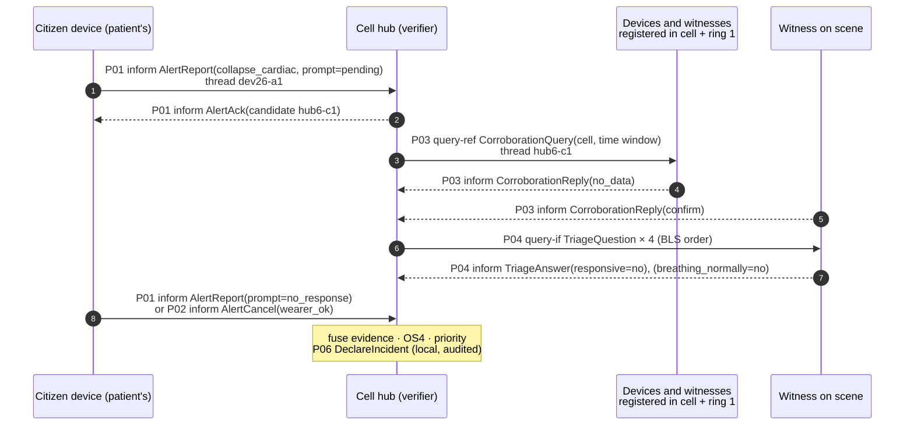
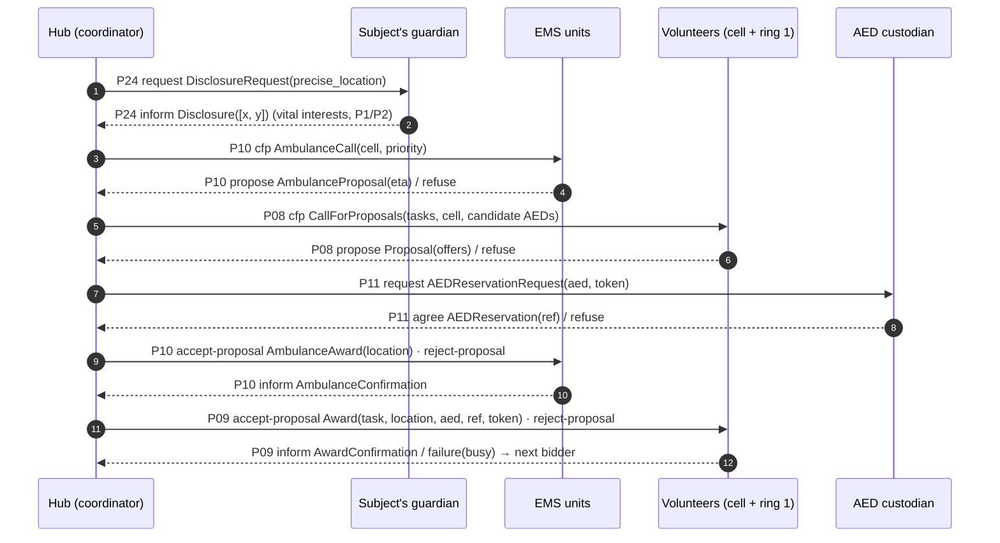
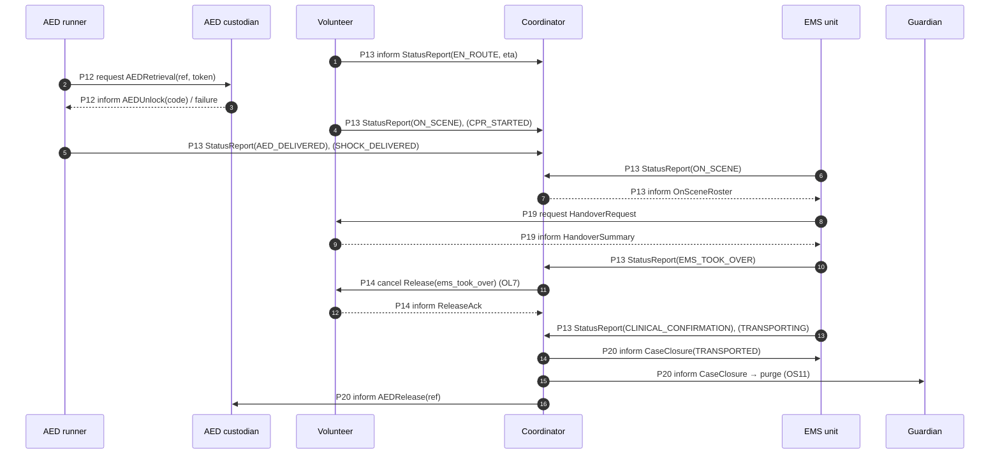

# Protocols and Message Schemas

ISIA 2026/27 · Assignment 1 · Topic O

This document fixes the message envelope, the conversation threads, the main conversations and the
schema of every message. Partners and FIPA patterns per protocol are in
[02-architectural-design.md](02-architectural-design.md) §4. The schemas follow the dataclasses in
`src/cemr/protocol/messages_*.py`, whose docstrings describe each field.

## 1. Envelope

Every message is a FIPA-ACL message carried by SPADE.

| FIPA-ACL parameter | SPADE field | Value |
|---|---|---|
| `:sender` / `:receiver` | `sender` / `to` | `<pseudonym>@localhost`, e.g. `hub6`, `vol23`, `dev26`; no civil identity (D7) |
| performative | metadata `performative` | `inform`, `cfp`, `propose`, `accept-proposal`, `reject-proposal`, `request`, `agree`, `refuse`, `query-ref`, `query-if`, `subscribe`, `cancel`, `failure`, `not-understood` |
| `:protocol` | metadata `protocol` | e.g. `P08-CallForResponders` |
| `:ontology` | metadata `ontology` | `cemr-v1` (`src/cemr/protocol/ontology.py`) |
| `:language` | metadata `language` | `json` |
| `:conversation-id` | `thread` | see §2 |
| `:reply-with` | metadata `seq` | per-sender sequence number; with the thread it makes retries idempotent (F5) |
| `:reply-by` | metadata `reply-by` | deadline in simulated seconds (P03, P04, P08, P10) |
| `:content` | `body` | JSON object whose `type` field names the payload (§5) |

Inside one process SPADE hands messages directly to the receiver, so the `NetworkModel` adds latency,
loss, coverage gaps and per-link FIFO order on the single send path (`CEMRAgent.send_to`). Every send
is logged (`kind = "msg"`) with its size, delay and whether it was dropped (metric M8).

A message whose content cannot be decoded is answered with `not-understood` on the same thread and
protocol, with content `{"reason": "<decoder error>"}` (`agents/base.py`, `not_understood_reply`). A
received `not-understood` is only logged, so two agents cannot keep exchanging them. No scenario
produces invalid messages, so this path does not affect any metric.

## 2. Conversation threads

| Thread | Example | Used by |
|---|---|---|
| Alert id `<source>-a<n>` | `dev26-a1` | P01, P02; the hub claims it for the candidate the alert joins |
| Case id `<hub>-c<n>` | `hub6-c1` | Everything else about a case: P03–P05, P08–P15, P18–P20, P24 |
| `reg-<pseudonym>` | `reg-vol23` | P25 |

The hub's case FSM receives every message on its threads. A volunteer's or ambulance's mission FSM
receives the case thread once it has accepted an award; before that, calls and awards go to the agent's
general handler.

## 3. Main conversations

The diagrams follow the implementation and were checked against the event log of a C1 run. Guidance
and failover are shown in [03-detailed-design.md](03-detailed-design.md) §2.6–2.7.

### 3.1 Detection and verification (SO-DV)

The hub declares as soon as the belief reaches `τ_declare(p)` and a branch of OS4 holds, and discards
if it falls below 0.03 or `W_max` expires.

### 3.2 Dispatch (SO-DR)

The precise location reaches volunteers only inside `Award` and the ambulance only inside
`AmbulanceAward` (OS5). If ring 1 yields no proposal, the call goes to ring 2.

### 3.3 On scene and closure

## 4. Implementation notes

All 28 protocols are implemented. P06, P07 and P21 are local hand-overs inside the hub, P16 and P17
local exchanges on the witness's phone, and P22 a read of the hub's own trust table with no messages.
Unanswered triage questions, location requests and releases are re-sent (F5). P10 is retried with
backoff while no unit is free, and P3 cases get no ambulance. P13 `EN_ROUTE` refreshes the award
deadline. P23 runs every 10 min, P27 heartbeats every 5 s with a 15 s lease. P25 registers volunteers up
to ring 2 and witnesses and devices up to ring 1. In P26, two candidates are the same incident if they
were opened within the merge window and their areas are at most 100 m apart.

## 5. Message schemas

Each row is one JSON body. Positions are `[x, y]` in metres; times are simulated seconds since the start
of the run; `?` marks a field that may be `null`. Alternatives are separated by `|`.

### Detection and verification (P01–P07, `messages_detection.py`)

| Protocol | Message · performative | Fields |
|---|---|---|
| P01 | `AlertReport` · inform | `alert_id` str (also the thread), `source_kind` sensor\|witness, `event_type` collapse_cardiac\|fall_immobile\|fall\|witness_collapse, `confidence` float in [0, 1], `cell` int, `area` [x, y] rounded to the 100 m grid (D7), `t_event` float, `policy` alert_first\|confirm_first\|human, `prompt_status` pending\|no_response\|not_applicable, `origin` str? (original source when relayed after P26) |
| P01 | `AlertAck` · inform | `alert_id` str, `candidate_id` str |
| P02 | `AlertCancel` · inform | `alert_id` str, `reason` wearer_ok\|witness_retracts, `t_event` float, `origin` str? |
| P02 | `CancelAck` · inform | `alert_id` str, `candidate_state` str |
| P03 | `CorroborationQuery` · query-ref | `candidate_id` str, `cell` int, `window_from` float, `window_to` float, `reply_by` float (no answer counts as no_data); never the precise location |
| P03 | `CorroborationReply` · inform | `candidate_id` str, `verdict` confirm\|deny\|no_data, `confidence` float, `area` [x, y]? (a confirmation from another area is ignored) |
| P03 | `CorroborationRefusal` · refuse | `candidate_id` str, `reason` str (e.g. consent) |
| P04 | `TriageQuestion` · query-if | `candidate_id` str, `question` scene_safe\|responsive\|breathing_normally\|called_112, `reply_by` float |
| P04 | `TriageAnswer` · inform | `candidate_id` str, `question` str, `answer` yes\|no\|unknown, `t_answer` float |
| P05 | `GuidanceActivation` · request | `candidate_id` str, `priority` str (provisional), `triage` dict (answers already obtained) |
| P05 | `GuidanceAck` · agree, refuse | `candidate_id` str, `accepted` bool |
| P06 | `Declaration` · inform, local | `case_id` str, `priority` P1\|P2\|P3, `confidence` float, `cell` int, `rule` str (OS4 branch used), `sources` list of pseudonyms |
| P07 | `Retraction` · inform, local | `case_id` str, `reason` str, `confidence` float |

`AlertCancel` travels as `inform`, not `cancel`: in FIPA `cancel` withdraws an action the sender had
requested, while here the source informs the hub that its alert was false.

### Dispatch (P08–P10, `messages_dispatch.py`)

| Protocol | Message · performative | Fields |
|---|---|---|
| P08 | `CallForProposals` · cfp | `case_id` str, `tasks` dict task → count (e.g. {GO_TO_PATIENT: 2, FETCH_AED: 1}), `cell` int (ETAs go to its centre), `priority` str, `min_qualification` str, `reply_by` float, `candidate_aeds` list of {aed_id, pos} |
| P08 | `Proposal` · propose | `case_id` str, `offers` list of {task, eta_s, aed_id?}, `qualification` NONE\|BLS\|BLS_AED\|HEALTH_PRO |
| P08 | `ProposalRefusal` · refuse | `case_id` str, `reason` busy\|declined\|unqualified\|load_cap |
| P09 | `Award` · accept-proposal | `case_id` str, `task` GO_TO_PATIENT\|FETCH_AED, `location` [x, y] (the only message that gives a volunteer the location, OS5), `arrive_by` float (ETA + δ, OL6), `aed_id` int?, `reservation_ref` str?, `award_token` str?, `guide` str? (witness device for P18) |
| P09 | `AwardRejection` · reject-proposal | `case_id` str |
| P09 | `AwardConfirmation` · inform | `case_id` str, `task` str |
| P09 | `AwardFailure` · failure | `case_id` str, `reason` str (busy since bidding) |
| P10 | `AmbulanceCall` · cfp | `case_id` str, `priority` P1\|P2, `cell` int, `reply_by` float |
| P10 | `AmbulanceProposal` · propose | `case_id` str, `eta_s` float (to the cell centre, dispatch delay included) |
| P10 | `AmbulanceRefusal` · refuse | `case_id` str, `reason` busy\|out_of_service |
| P10 | `AmbulanceAward` · accept-proposal | `case_id` str, `priority` P1\|P2, `location` [x, y] |
| P10 | `AmbulanceRejection` · reject-proposal | `case_id` str |
| P10 | `AmbulanceConfirmation` · inform | `case_id` str |
| P10 | `AmbulanceFailure` · failure | `case_id` str, `reason` str |

### Response and closure (P11–P14, P20, `messages_response.py`)

| Protocol | Message · performative | Fields |
|---|---|---|
| P11 | `AEDReservationRequest` · request | `case_id` str, `aed_id` int, `valid_for_s` float, `priority` str, `award_token` str |
| P11 | `AEDReservation` · agree | `case_id` str, `aed_id` int, `reservation_ref` str, `expires_at` float |
| P11 | `AEDReservationRefusal` · refuse | `case_id` str, `aed_id` int, `reason` reserved\|in_use\|unavailable |
| P11 | `AEDReservationCancel` · cancel | `case_id` str, `aed_id` int, `reservation_ref` str |
| P12 | `AEDRetrieval` · request | `case_id` str, `aed_id` int, `reservation_ref` str, `award_token` str |
| P12 | `AEDUnlock` · inform | `case_id` str, `aed_id` int, `access_code` str (single use) |
| P12 | `AEDRetrievalFailure` · failure | `case_id` str, `aed_id` int, `reason` missing_or_faulty\|invalid_reservation\|expired |
| P13 | `StatusReport` · inform | `case_id` str, `status` EN_ROUTE\|AT_AED\|AED_OK\|AED_MISSING\|ON_SCENE\|CPR_STARTED\|AED_DELIVERED\|SHOCK_DELIVERED\|WITNESS_SILENT\|EMS_TOOK_OVER\|CLINICAL_CONFIRMATION\|TRANSPORTING\|WITHDRAWN\|UNSAFE_SCENE, `t_status` float, `eta_s` float? (EN_ROUTE), `detail` dict (e.g. {real_incident: bool}) |
| P13 | `OnSceneRoster` · inform | `case_id` str, `responders` list of volunteers on scene |
| P14 | `Release` · cancel | `case_id` str, `reason` enough_on_scene\|false_alarm\|ems_took_over |
| P14 | `ReleaseAck` · inform | `case_id` str |
| P20 | `CaseClosure` · inform | `case_id` str, `outcome` FALSE_ALARM\|RESOLVED_ON_SCENE\|TRANSPORTED\|TIMEOUT, `t_closed` float (purge by `t_closed + T_ret`, OS11) |
| P20 | `AEDRelease` · inform | `case_id` str, `aed_id` int, `reservation_ref` str |

### Bystander assistance (P15–P19, `messages_assistance.py`)

| Protocol | Message · performative | Fields |
|---|---|---|
| P15 | `HelpEnRoute` · inform | `case_id` str, `eta_responder_s` float?, `eta_aed_s` float?, `eta_ems_s` float? |
| P16 | `Instruction` · request, local | `case_id` str, `step` str (from `guidanceProtocol`, OS12), `text` str, `cadence_per_min` int?, `expected_s` float |
| P17 | `Feedback` · inform, local | `case_id` str, `result` DONE\|CANNOT\|BREATHING\|WOKE_UP\|TIRED\|AED_ARRIVED, `t_feedback` float |
| P18 | `TakeoverRequest` · request | `case_id` str, `arriving_role` str (never an identity) |
| P18 | `ActionSummary` · inform | `case_id` str, `cpr_started_at` float? |
| P19 | `HandoverRequest` · request | `case_id` str |
| P19 | `HandoverSummary` · inform | `case_id` str, `collapse_estimate_t` float?, `cpr_start_t` float?, `shocks` int, `first_shock_t` float?, `current_state` str |

### Between hubs, trust and privacy (P21–P28, `messages_hubs.py`)

| Protocol | Message · performative | Fields |
|---|---|---|
| P21 | `OutcomeLabels` · inform, local | `case_id` str, `labels` list of {pseudonym, kind source\|responder, success bool} |
| P23 | `ReputationSummary` · inform | `entries` list of {pseudonym, alpha, beta} |
| P24 | `DisclosureRequest` · request | `case_id` str, `field_name` precise_location\|building_access\|clinical\|identity, `purpose` str, `priority` str, `recipients` list |
| P24 | `Disclosure` · inform | `case_id` str, `field_name` str, `value` list\|dict\|str |
| P24 | `DisclosureRefusal` · refuse | `case_id` str, `field_name` str, `reason` str (e.g. not_need_to_know) |
| P25 | `Registration` · subscribe | `role` volunteer\|witness\|sensor, `qualification` str, `cell` int, `ring` int (distance to the hub's cell); no coordinates |
| P25 | `RegistrationAck` · agree | `hub_cell` int |
| P25 | `Deregistration` · cancel | `role` str |
| P26 | `CandidateNotice` · inform | `candidate_id` str, `cell` int, `area` [x, y]?, `t_open` float, `event_type` str |
| P26 | `CandidateMerge` · inform | `candidate_id` str (dropped), `keeper_id` str (first opened, then lower hub id), `alerts` list of {origin, report} |
| P27 | `CaseSnapshot` · inform | `case_id` str, `state` str, `priority` str, `cell` int, `t_open` float, `subject` str? (guardian to ask again, P24), `ems` str?, `awards` dict volunteer → {task, eta_s, aed_id, status}, `guides` list, `sources` list, `reservation` {aed_id, ref, token}?, `closed` bool; no location or clinical data (D7) |
| P27 | `Heartbeat` · inform | `open_cases` list, `lease_until` float |
| P27 | `HeartbeatAck` · inform | `lease_until` float |
| P28 | `Takeover` · inform | `case_id` str, `new_coordinator` str |
