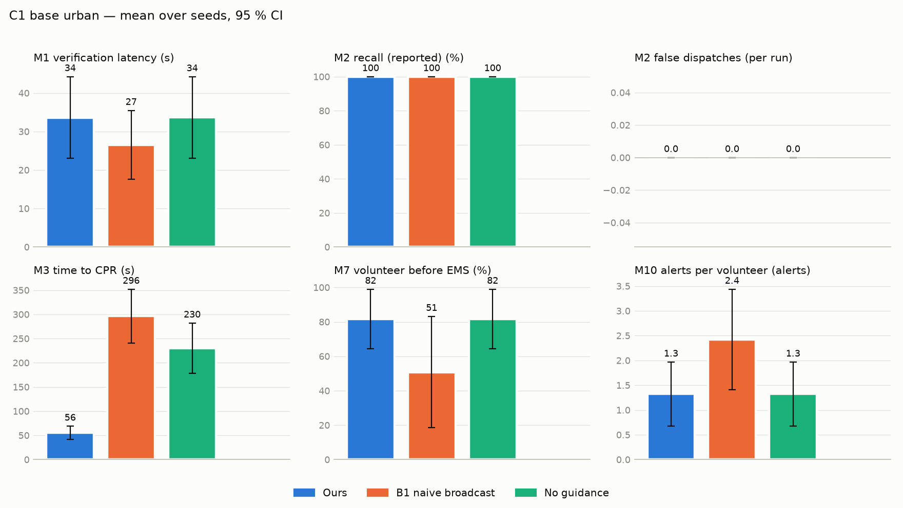
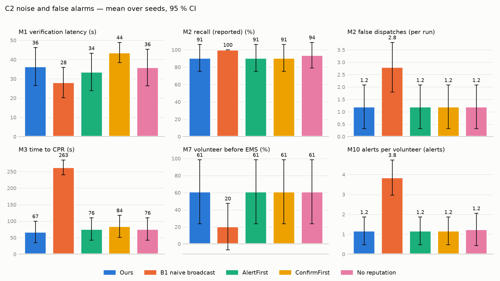
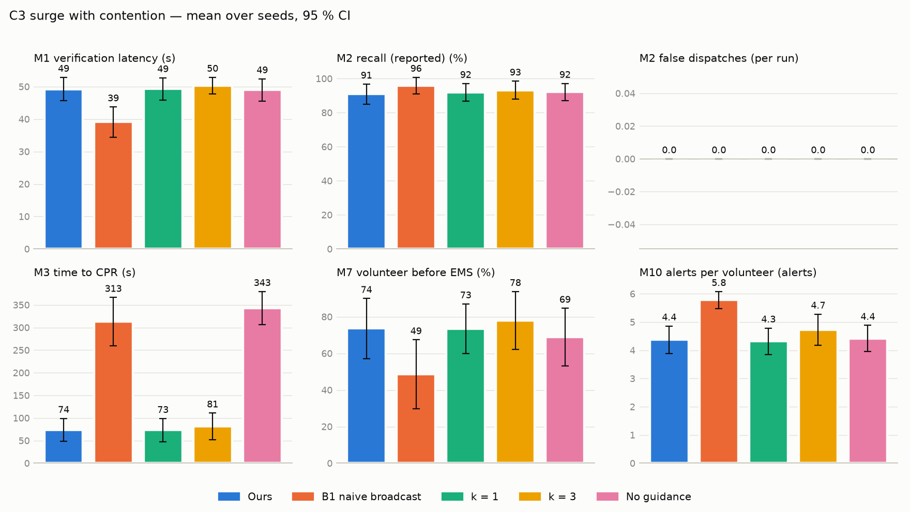
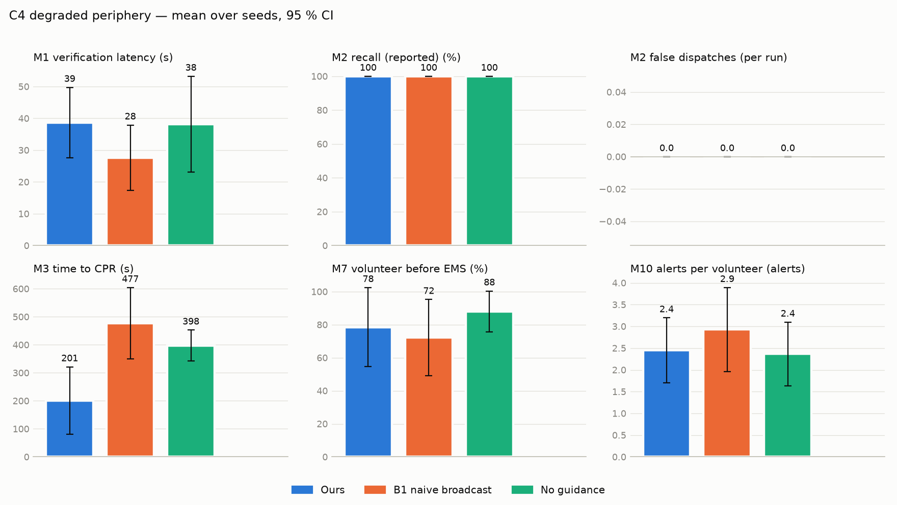
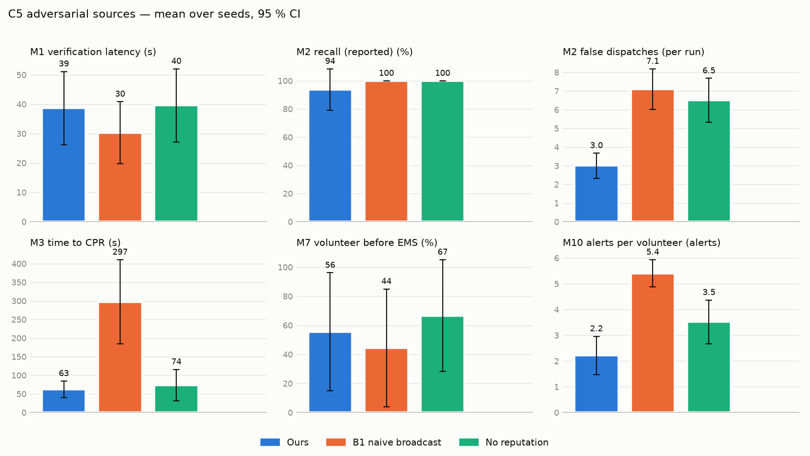

Todos os números deste relatório vêm da matriz final de experiências: 210 runs válidos, todos sobre o
commit `de13290` (tag `matrix-final`). As tabelas completas estão em `results/summary.md` (médias),
`results/paired.md` (diferenças emparelhadas por seed), `results/misses.md` (incidentes falhados por
motivo) e `results/evolution.md` (evolução do desenho). O desenho do sistema está em `docs/02` a
`docs/04` e não é repetido aqui.

# 1. Introdução

O sistema deteta paragens cardiorrespiratórias e outros incidentes médicos urgentes, verifica-os
localmente e despacha voluntários, desfibrilhadores (DAE) e ambulâncias sem despachante central. A
cidade está dividida em células; o armário de DAE de cada célula é o hub que verifica os alertas,
coordena os casos por Contract Net (Smith, 1980) e mantém a reputação das fontes com o modelo Beta
(Jøsang e Ismail, 2002). As testemunhas recebem no telemóvel uma guia de RCP passo a passo.

A avaliação procura responder a uma pergunta por cenário. Escolhemos cinco cenários contrastantes,
acima dos três pedidos no enunciado, porque cada mecanismo do desenho (verificação, alocação,
reputação, guia e recuperação de falhas) só é posto à prova numa situação própria.

| Cenário | O que muda face a C1 | Pergunta |
|---|---|---|
| C1 base urbana | Densidade média, sensores fiáveis, boa rede | O fluxo funciona? Com que frequência chega um voluntário antes da ambulância? |
| C2 ruído | Falsos positivos dos sensores ×5, sensores com deriva, testemunhas que leem mal a cena | A corroboração e a reputação mantêm a precisão? AlertFirst ou ConfirmFirst? |
| C3 pico | 8 incidentes em 10 min num raio de 400 m | Os doentes ficam separados? A exclusividade e a prioridade evitam conflitos? Quanta redundância compensa? |
| C4 periferia | Metade dos voluntários, metade dos DAE fechados, ambulâncias longe, zonas sem rede, crash do hub 2 aos 1200 s | A guia e a realocação aguentam? Quanto custa recuperar um coordenador? |
| C5 adversarial | A cidade de C1 com duas pessoas que relatam colapsos falsos, 4 por hora cada | A reputação trava relatos falsos repetidos, e a que custo? |

# 2. Método

## 2.1 Configurações e baselines

Comparamos o sistema tal como foi desenhado ("nosso") com duas baselines. A B1, difusão ingénua,
declara o caso no primeiro alerta, chama todos os voluntários até ao segundo anel de células e
adjudica a quem responde primeiro, sem reputação (`docs/03` §4.2). O B0 é um oráculo centralizado
calculado offline sobre o mesmo traço de incidentes: conhece a hora e o local de cada colapso e a
posição de todos os voluntários, e despacha logo o melhor. Não é atingível; serve de referência para a
métrica M9.

As variantes isolam um mecanismo de cada vez:

- C1: perda de 10 % e de 20 % das mensagens nas ligações dos telemóveis (robustez, M12) e o sistema sem
  a guia da testemunha;
- C2: política do sensor AlertFirst (alerta logo) e ConfirmFirst (pergunta primeiro ao portador), em
  vez da adaptativa do nosso (AlertFirst só para sinais de P1), e o sistema sem reputação;
- C3: redundância k = 1 e k = 3 voluntários de RCP por P1 (o nosso usa k = 2) e o sistema sem guia;
- C4: o sistema sem guia;
- C5: o sistema sem reputação.

Com a B1 em todos os cenários, são 21 configurações. Cada uma correu com as seeds 1 a 10, o que dá 210
runs de 60 minutos simulados, com o relógio acelerado 10 vezes. A seed fixa a cidade, as posições e o
traço de incidentes, por isso as configurações de um mesmo cenário veem exatamente os mesmos
incidentes e podem ser comparadas seed a seed. Cada run tem o seu próprio servidor XMPP. Um run é
inválido se o relógio simulado não avançou como devia (por exemplo, se o computador suspendeu); os 210
runs da matriz final são todos válidos.

## 2.2 Métricas

As métricas foram definidas na análise Gaia (`docs/01`, §8.1) e são calculadas a partir do event log
de cada run (`src/cemr/metrics/compute.py`). As métricas de tempo contam desde o colapso e usam a
mediana dentro de cada run; só incluem os incidentes detetáveis, os que têm um dispositivo ou uma
testemunha, porque os outros só seriam apanhados por uma chamada para o 112, que não simulamos.

| Métrica | Definição |
|---|---|
| M1 latência de verificação | Tempo até à declaração do caso (P1/P2) |
| M2 verificação | Precisão; recall sobre os incidentes detetáveis e sobre os reportados; falsos despachos por run (caso declarado e localizado onde não há doente) |
| M3 tempo até RCP | Tempo até ao início da RCP (P1) e percentagem iniciada pela testemunha |
| M4 tempo até DAE | Tempo até o DAE estar colocado no doente (P1) |
| M5 tempo até EMS | Tempo até a ambulância chegar (P1/P2) |
| M6 proxy de sobrevivência | Modelo de Larsen et al. (1993) para os P1 desfibrilháveis; serve só para comparar estratégias |
| M7 cobertura antes da EMS | Percentagem de P1 com voluntário (ou DAE) no local antes da ambulância |
| M8 mensagens | Mensagens por candidato a caso, sem as de fundo (registos P25, gossip P23, heartbeats P27) |
| M9 distância ao oráculo | Atraso do primeiro voluntário face ao B0, contado desde a declaração |
| M10 carga dos voluntários | Alertas por voluntário, índice de Jain das tarefas, minutos gastos em falsos alarmes |
| M11 exposição | Agentes que recebem a localização exata ou dados clínicos, por caso |
| M12 robustez | Tempo até o sucessor assumir os casos de um hub que falhou; casos órfãos |
| M13 equidade | M3 no centro da cidade e na periferia |

Além das métricas, o verificador de regras (`src/cemr/metrics/check.py`) relê o event log de cada run
e conta as violações das regras organizacionais da análise Gaia (um só dono por caso, uma reserva por
DAE, divulgação só a quem precisa, entre outras) e da regra DUP, acrescentada no desenho: nenhum
incidente tratado por dois casos declarados.

## 2.3 Análise estatística

Para cada configuração apresentamos a média sobre as seeds com o intervalo de confiança a 95 % da
t de Student. Como as seeds são as mesmas em todas as configurações de um cenário, a comparação
principal é emparelhada: para cada seed calculamos variante − nosso, e reportamos a média dessas
diferenças com o seu IC a 95 % e em quantas seeds o nosso foi melhor. Uma diferença cujo IC exclui 0
está acima da variação entre seeds; quando o IC inclui 0, não tiramos conclusões.

Uma métrica fica indefinida num run quando não há eventos para a medir (por exemplo, M3 sem nenhuma
RCP). O n de cada célula das tabelas é o número de seeds em que a métrica existe. Isto tem um efeito a
ter em conta: em C1, a B1 tem M3 só em 7 das 10 seeds, porque nas outras três ninguém chegou a fazer
RCP; a sua média de M3 é por isso otimista.

## 2.4 Reprodução

```bash
python experiments/run_matrix.py --matrix main --seeds 1-10 --workers 4
python experiments/analyse.py        # summary, paired, misses e figuras em results/
python -m cemr.metrics.check runs/main/<run> -v
```

O `run_matrix.py` recusa correr com alterações por fazer commit em `src/`, `scenarios/` ou
`experiments/`, e o `analyse.py` recusa um `runs.csv` que misture commits; cada `summary.json` regista
o commit do código.

# 3. Resultados por cenário

As figuras mostram as médias com IC a 95 % de seis métricas por cenário. As versões emparelhadas estão
em `results/fig_c*_paired.png`. Nas tabelas, "Δ" é a diferença emparelhada variante − nosso.

## 3.1 C1 base urbana

| Métrica | Nosso | B1 | Sem guia | Perda 10 % | Perda 20 % |
|---|---|---|---|---|---|
| M1 verificação (s) | 33,5 ± 10,7 | 26,4 ± 8,6 | 33,6 ± 10,5 | 39,9 ± 13,7 | 41,8 ± 8,0 |
| M2 recall, reportados (%) | 100,0 | 100,0 | 100,0 | 100,0 | 84,2 ± 22,9 |
| M3 tempo até RCP (s) | 52,2 ± 12,4 | 306,5 ± 41,3 | 229,8 ± 51,8 | 175,4 ± 108,3 | 176,7 ± 114,1 |
| M3 RCP pela testemunha (%) | 95,0 ± 11,3 | 0,0 | 0,0 | 55,0 ± 31,3 | 66,7 ± 33,3 |
| M6 sobrevivência (%) | 41,8 ± 4,7 | 31,3 ± 4,0 | 34,7 ± 4,6 | 28,5 ± 9,0 | 20,0 ± 11,7 |
| M8 mensagens por candidato | 165,8 ± 10,1 | 127,1 ± 4,7 | 160,8 ± 9,7 | 118,9 ± 15,4 | 110,2 ± 37,2 |
| M10 alertas por voluntário | 1,3 ± 0,6 | 2,4 ± 1,0 | 1,3 ± 0,6 | 1,3 ± 0,7 | 1,1 ± 0,4 |
| Violações de regras (por run) | 0,0 | 0,0 | 0,0 | 0,2 ± 0,3 | 0,4 ± 0,5 |



Na cidade base, o fluxo completo funciona: a precisão é de 100 % em todas as configurações, o recall
sobre os incidentes reportados também, exceto com 20 % de perda, e não há falsos despachos. O nosso sistema põe alguém a
fazer RCP em 52 s, contra 307 s com a B1 (Δ = +258 ± 39 s, melhor em 7 de 7 seeds). O proxy de
sobrevivência sobe de 31,3 % para 41,8 % (Δ = −10,5 ± 1,7 pontos para a B1).

A variante sem guia separa as duas causas deste ganho. Sem guia, o M3 sobe para 230 s
(Δ = +178 ± 51 s): a maior parte do ganho vem de a testemunha começar a RCP guiada pelo telemóvel,
que acontece em 95 % dos casos. Para medir só a coordenação (verificação, Contract Net e reputação),
comparamos duas configurações que não têm guia, B1 e "sem guia": a coordenação encurta a RCP em
55 ± 51 s, melhor em 6 de 7 seeds, aproxima o primeiro voluntário do oráculo em 63 ± 45 s (M9) e
reduz os alertas por voluntário em 1,1 ± 0,4. O IC do M3 exclui 0, mas por pouco.

A perda de mensagens degrada o sistema de forma visível. Com 10 % de perda, o M3 sobe 123 ± 102 s e a
RCP iniciada pela testemunha cai de 95 % para 55 %; com 20 %, o M6 cai 21,8 ± 12,3 pontos e o recall
sobre os reportados cai para 84 % (Δ = −15,8 ± 22,9, IC que inclui 0). A queda da RCP pela testemunha
tem uma explicação provável no código: a ativação da guia (P05) é enviada uma só vez a cada testemunha
(`activate_guidance` em `src/cemr/agents/case_verify.py`) e, ao contrário da triagem, não é reenviada
quando se perde. Não confirmámos esta explicação nos event logs da matriz, que não guardámos. As duas
variantes com perda são também as únicas configurações de C1 com violações de regras: cinco casos
duplicados entre células (DUP) e uma violação de OL3 em 20 runs.

## 3.2 C2 ruído e falsos alarmes

| Métrica | Nosso | B1 | AlertFirst | ConfirmFirst | Sem reputação |
|---|---|---|---|---|---|
| M1 verificação (s) | 40,6 ± 13,8 | 30,5 ± 10,7 | 39,3 ± 13,6 | 47,3 ± 10,7 | 41,0 ± 13,8 |
| M2 precisão (%) | 23,1 ± 13,8 | 24,9 ± 10,6 | 22,5 ± 14,9 | 24,9 ± 13,4 | 22,6 ± 12,1 |
| M2 recall, detetáveis (%) | 75,6 ± 33,4 | 83,0 ± 25,7 | 75,6 ± 33,4 | 79,3 ± 28,5 | 79,3 ± 28,5 |
| M2 falsos despachos por run | 4,7 ± 2,0 | 9,4 ± 2,1 | 4,6 ± 2,0 | 4,9 ± 1,9 | 5,8 ± 2,3 |
| M8 mensagens por candidato | 104,7 ± 7,0 | 93,3 ± 7,5 | 93,0 ± 5,9 | 120,4 ± 9,8 | 111,5 ± 5,9 |
| M10 alertas por voluntário | 3,0 ± 0,9 | 5,9 ± 0,1 | 2,9 ± 0,9 | 3,1 ± 0,7 | 3,5 ± 0,9 |
| M10 minutos em falsos alarmes | 47,7 ± 22,6 | 62,5 ± 18,9 | 48,0 ± 23,9 | 50,9 ± 22,0 | 59,5 ± 25,4 |



Com sensores ruidosos, a precisão é baixa em todas as configurações, entre 22 % e 25 %, e não difere
entre o nosso sistema e a B1 (Δ = +1,8 ± 12,1). A precisão baixa é em parte estrutural: há cerca de
dois incidentes P1/P2 por run (23 em 10 seeds), e com tão poucos casos verdadeiros alguns falsos
despachos chegam para a fazer cair. A diferença está no número de falsos despachos, que a verificação
corta para metade (4,7 contra 9,4 por run; Δ = +4,7 ± 1,4, melhor em 10 de 10 seeds). Quase todos os
que a B1 tem a mais vêm só de sensores (7,4 contra 2,9 por run), e são precisamente os que a
corroboração e a pergunta ao portador filtram. Os falsos despachos com testemunha quase não mudam
(1,8 contra 2,0): uma testemunha que lê mal a cena passa a verificação pelo ramo do relato humano
fiável. A verificação também poupa os voluntários: 3,0 alertas por voluntário contra 5,9, e 15 ± 11
minutos a menos gastos em falsos alarmes por run.

O custo aparece no recall. A B1 apanha mais 7,4 pontos de recall sobre os detetáveis, embora com um IC
de ±17,1 que inclui 0. Segundo o diagnóstico de `results/misses.md`, em 23 P1/P2 o nosso sistema
perdeu mais dois do que a B1: um descartado como P3 e um fundido com outro doente. A B1, que declara
no primeiro alerta, não tem perdas destes tipos.

As duas políticas do sensor dão resultados quase iguais. Nenhuma diferença emparelhada de precisão,
recall, falsos despachos ou M1 exclui 0; a média de M1 da ConfirmFirst é maior (47 contra 39 s), mas
o IC emparelhado face ao nosso é de +3,9 ± 10,5 s. A diferença clara é o custo em mensagens: a
AlertFirst gasta 11,7 ± 4,3 mensagens a menos por candidato e a ConfirmFirst 15,7 ± 7,8 a mais. A
reputação tem aqui um efeito pequeno mas mensurável: sem ela há mais 1,1 ± 0,8 falsos despachos por
run e mais 11,8 ± 9,0 minutos em falsos alarmes. Cada sensor com deriva dá 3 falsos positivos por hora
(`docs/03` §7), por isso em 60 minutos a reputação tem poucos casos de onde aprender.

## 3.3 C3 pico com contenção

| Métrica | Nosso (k = 2) | B1 | k = 1 | k = 3 | Sem guia |
|---|---|---|---|---|---|
| M2 recall, detetáveis (%) | 80,3 ± 10,8 | 81,5 ± 9,6 | 80,3 ± 10,8 | 80,3 ± 10,8 | 81,5 ± 9,6 |
| M3 tempo até RCP (s) | 75,1 ± 25,2 | 361,6 ± 81,0 | 75,4 ± 24,9 | 75,0 ± 25,0 | 339,3 ± 36,6 |
| M7 voluntário antes da EMS (%) | 74,5 ± 16,2 | 49,2 ± 15,4 | 76,3 ± 15,0 | 79,6 ± 16,6 | 74,5 ± 16,2 |
| M8 mensagens por candidato | 218,4 ± 16,0 | 146,3 ± 10,8 | 212,6 ± 15,9 | 232,0 ± 18,8 | 208,7 ± 15,6 |
| M9 distância ao oráculo (s) | 162,0 ± 48,5 | 195,8 ± 90,1 | 169,3 ± 46,3 | 143,2 ± 34,3 | 161,8 ± 48,7 |
| M10 índice de Jain das tarefas | 0,5 ± 0,1 | 0,6 ± 0,1 | 0,3 ± 0,1 | 0,6 ± 0,1 | 0,5 ± 0,1 |
| M11 agentes com a localização | 4,8 ± 0,6 | 5,1 ± 0,3 | 3,7 ± 0,3 | 6,5 ± 1,2 | 4,8 ± 0,7 |



No pico de oito incidentes em dez minutos, o sistema mantém os doentes separados na maior parte dos
casos: o recall sobre os detetáveis é de 80 %, igual ao da B1. Dos 94 P1/P2 das dez seeds, 9 são
indetetáveis, 14 não chegaram a ser reportados e 3 foram fundidos com outro doente
(`results/misses.md`). Estes três aparecem em todas as configurações, incluindo a B1, porque vêm da
fusão de alertas por área e não da verificação. As regras de exclusividade (um compromisso por
voluntário, uma reserva por DAE) não tiveram nenhuma violação em nenhuma das 50 runs de C3.

A redundância k quase não mexe no tempo até à RCP (75 s com k = 1, 2 e 3), porque com a guia é a
testemunha que começa a RCP em 86 a 88 % dos casos. O que k muda são os custos. Com k = 3, a
localização exata chega a mais 1,7 ± 0,8 agentes por caso e há mais 13,6 ± 5,1 mensagens por
candidato; em troca, o primeiro voluntário fica 18,8 s mais perto do oráculo, com um IC de ±49,0 s
que inclui 0. Com k = 1 a exposição baixa (−1,1 ± 0,4 agentes), mas as tarefas concentram-se em menos
voluntários: o índice de Jain cai 0,2 ± 0,1. Mantivemos k = 2 como compromisso entre exposição e
equidade, sabendo que os dados não mostram um ganho de tempo com mais redundância.

Face à B1, a coordenação sem guia não encurta a RCP de forma clara (Δ = +22 ± 68 s), mas põe um
voluntário no local antes da ambulância em mais 25 ± 17 pontos percentuais dos P1, com menos alertas
por voluntário (4,5 contra 5,8) e mais mensagens por candidato (B1 − sem guia: Δ = −62 ± 8).

## 3.4 C4 periferia degradada

| Métrica | Nosso | B1 | Sem guia |
|---|---|---|---|
| M3 tempo até RCP (s) | 164,4 ± 107,5 | 383,1 ± 83,0 | 411,1 ± 52,2 |
| M3 RCP pela testemunha (%) | 60,0 ± 26,5 | 0,0 | 0,0 |
| M5 tempo até EMS (s) | 759,7 ± 79,2 | 831,6 ± 186,7 | 863,4 ± 216,6 |
| M6 sobrevivência (%) | 16,1 ± 6,8 | 9,1 ± 5,4 | 12,8 ± 6,5 |
| M7 voluntário antes da EMS (%) | 91,0 ± 10,8 | 70,2 ± 23,1 | 95,0 ± 7,5 |
| M7 DAE antes da EMS (%) | 46,5 ± 30,3 | 15,3 ± 15,4 | 49,7 ± 31,4 |
| M12 recuperação após o crash (s) | 21,1 ± 1,7 | 22,2 ± 1,7 | 20,8 ± 1,9 |
| Violações de regras (por run) | 0,0 | 0,3 ± 0,3 | 0,6 ± 0,5 |



Na periferia, a ambulância demora em média 12,7 minutos, e o intervalo até lá chegar é onde o sistema
mais conta. O nosso sistema começa a RCP em 2,7 minutos, contra 6,4 com a B1 (Δ = +258 ± 91 s, melhor
em 9 de 9 seeds), e o proxy de sobrevivência passa de 9,1 % para 16,1 %. A guia volta a explicar a
maior parte da diferença na RCP: sem ela, o M3 sobe para 411 s. A coordenação sozinha não encurta a
RCP (B1 − sem guia: Δ = −18 ± 117 s), mas leva voluntários e DAE ao doente antes da ambulância mais
vezes: mais 25 ± 23 pontos percentuais de voluntários e mais 34 ± 31 de DAE.

O hub 2 cai aos 1200 s em todas as runs de C4. O sucessor assume os casos em 21,1 ± 1,7 s, sem nenhum
caso órfão nas 30 runs. Este tempo é quase todo fixado pelos parâmetros: a lease dura três heartbeats
de 5 s e o sucessor espera mais um heartbeat antes de assumir (`scenarios/defaults.toml`), o que dá
20 s. O M12 mostra que o failover funciona, mas não mede uma propriedade emergente.

A configuração principal não teve violações de regras em C4. A B1 teve 3 e a variante sem guia 6,
todas casos duplicados entre células (DUP). O P26 resolve um duplicado com uma troca de avisos entre
os dois hubs (`docs/02` §D8), mas o hub não espera pela resposta antes de declarar; se um aviso se
perde ou chega depois da declaração, o doente fica com dois casos. C4 tem 5 % de perda e zonas sem
rede, o que torna isto mais provável. Não sabemos porque é que a variante sem guia duplica mais casos
do que o sistema completo (Δ = +0,6 ± 0,5 por run); não analisámos esses runs.

As métricas de equidade (M13) têm intervalos demasiado largos para uma conclusão (por exemplo, M3 no
centro de 258 ± 244 s, com n = 6), por isso não as discutimos.

## 3.5 C5 fontes adversárias

| Métrica | Nosso | B1 | Sem reputação |
|---|---|---|---|
| M2 precisão (%) | 28,3 ± 15,0 | 15,3 ± 7,6 | 15,8 ± 7,6 |
| M2 falsos despachos por run | 3,0 ± 0,7 | 7,1 ± 1,1 | 6,9 ± 1,2 |
| M3 tempo até RCP (s) | 82,8 ± 64,0 | 279,5 ± 61,0 | 77,3 ± 44,8 |
| M8 mensagens por candidato | 110,7 ± 12,2 | 109,7 ± 5,8 | 140,6 ± 10,7 |
| M10 alertas por voluntário | 2,3 ± 0,7 | 5,4 ± 0,5 | 3,7 ± 0,8 |
| M10 minutos em falsos alarmes | 22,9 ± 8,3 | 105,8 ± 12,9 | 47,0 ± 14,3 |



As duas fontes adversárias descrevem uma pessoa inconsciente que respira (P2). Sem reputação, cada
relato passa a verificação pelo ramo do relato humano fiável, e há 6,9 falsos despachos por run. Com a
reputação, há 3,0 (Δ = +3,9 ± 1,4, melhor em 10 de 10 seeds), a precisão sobe de 15,8 % para 28,3 % e os
voluntários gastam metade dos minutos em falsos alarmes (Δ = +24,1 ± 14,7). A reputação também
poupa mensagens, porque há menos casos (Δ = +29,9 ± 8,2 mensagens por candidato sem ela).

Não encontrámos custo para os casos verdadeiros: o tempo até à RCP é o mesmo com e sem reputação
(Δ = −0,3 ± 36,8 s), e o recall não muda. Os 3,0 falsos despachos que restam vêm do modo como o modelo
Beta aprende: a confiança numa fonte só desce quando um caso em que ela participou é fechado como falso
alarme (P21, `docs/03` §4.5), por isso os primeiros relatos de cada fonte adversária ainda passam.

# 4. Trade-offs

**Verificar custa tempo.** A B1 declara no primeiro alerta, e o nosso sistema demora mais 7 a 14 s a
declarar em todos os cenários (Δ de M1 entre −7,0 ± 2,7 s em C1 e −13,6 ± 7,7 s em C4). Esse atraso
passa para a ambulância: com a B1 ela chega 6,6 ± 3,0 s mais cedo em C1 e 12,1 ± 3,7 s em C3. Em troca,
os falsos despachos caem para metade em C2 e C5, e os voluntários recebem menos alertas. Como a RCP
guiada começa durante a verificação (a guia é ativada com a triagem, antes da declaração, pela regra
OL3), o atraso não chega à RCP.

**Mensagens contra fadiga dos voluntários.** O Contract Net troca mais mensagens por candidato do que
a difusão ingénua: mais 30 % em C1, 49 % em C3 e 39 % em C4. Em contrapartida, cada voluntário recebe
menos alertas, de −22 % (C3) a −57 % (C5). Preferimos esta troca, porque o recurso escasso é a atenção
dos voluntários e não a rede. As mensagens dos casos são, aliás, uma parte pequena do total: as
mensagens de fundo (registos, gossip e heartbeats) são cerca de 16 000 por run, 97 % do total em C1. É
o custo fixo da descentralização, e não depende do número de incidentes.

**Redundância, exposição e proximidade do ótimo.** Mais voluntários por P1 aproximam o primeiro do
oráculo (k = 3: 143 s, contra 169 s com k = 1, mas com IC que inclui 0) e espalham as tarefas, mas
enviam a localização exata a mais agentes e trocam mais mensagens (secção 3.3). Com a guia ativa, k
não muda o tempo até à RCP.

**Guia contra coordenação.** Em C1, C3 e C4, a guia da testemunha explica a maior parte do ganho na
RCP. A coordenação acrescenta ganhos de outro tipo: voluntários e DAE antes da ambulância, menos alertas
e menos falsos despachos. Só em C1 encurta também a RCP de forma clara.

**Política do sensor.** A adaptativa, a AlertFirst e a ConfirmFirst dão a mesma precisão e o mesmo
recall em C2; a AlertFirst é a mais barata em mensagens. Não vemos razão para perguntar primeiro ao portador quando o
hub já corrobora o alerta.

# 5. Evolução do desenho

Três alterações ao desenho vieram da leitura de matrizes anteriores. Cada uma foi medida nas mesmas
seeds antes e depois (`results/evolution.md`, `docs/03` §7.1). Entre dois commits pode haver mais do
que uma alteração, por isso cada linha mede o efeito de tudo o que mudou entre eles.

| Alteração | Medida | Antes → depois |
|---|---|---|
| Fundir alertas por área de 100 m, em vez de por célula | C3, recall detetáveis, seeds 1-5 | 64,0 → 77,5 % (+13,5 ± 13,3) |
| Repetir a triagem que contradiz o relato | C3, recall detetáveis, seeds 1-10 | 75,8 → 80,3 % (+4,5 ± 4,2) |
| A mesma fonte conta uma só vez por candidato | C5, falsos despachos por run, seeds 1-10 | 3,0 → 3,0 (sem efeito) |

A fusão por célula juntava num só caso dois doentes da mesma célula. A triagem repetida acabou com os
P1/P2 descartados como P3 em C3 (de 3 para 0, segundo o diagnóstico de `misses.py`). A terceira
alteração não teve efeito em C5, porque aí os falsos despachos vêm de testemunhas e cada uma envia um
só relato por incidente. Mantivemo-la porque é a fusão de evidência correta (fontes independentes), e
não por um ganho medido.

# 6. Limitações

O ambiente é sintético. A cidade é uma grelha de 3 × 3 km com distâncias de Manhattan, e o
comportamento das pessoas (aceitar uma chamada, desistir da RCP, cansar-se) segue modelos com
parâmetros escolhidos por nós, sem calibração empírica. A ambulância foi modelada com 240 s de ativação
e 30 km/h; não encontrámos uma fonte para os tempos de resposta urbanos em Portugal, e os valores
absolutos de M5 dependem diretamente desta escolha.

Não simulamos o caminho 112. Os incidentes sem dispositivo nem testemunha contam como falhados, e as
métricas de tempo só cobrem os detetáveis. O recall sobre todos os incidentes é por isso um limite
inferior, e a comparação com a B1 é feita sobre os mesmos incidentes, mas não com o sistema real de
emergência.

O M6 usa o modelo de Larsen et al. (1993), feito para paragens testemunhadas em fibrilhação
ventricular. É um proxy para comparar configurações, não uma previsão clínica.

A amostra é pequena. Com 10 seeds e 60 minutos simulados por run, há poucos P1 por run (16 em 10 seeds
em C2 e C5), e várias métricas têm IC largos ou n reduzido: o M4 tem n = 1 em C2, e as médias da B1 em
M3 excluem as seeds em que ninguém fez RCP. Runs mais longos dariam também mais tempo à reputação para
aprender com sensores com deriva.

Ficam dois defeitos conhecidos. Os casos duplicados entre células (15 das 16 violações de regras da
matriz; nenhuma na configuração principal) aparecem quando um aviso P26 entre hubs vizinhos se perde
ou chega depois da declaração. E a ativação da guia não é reenviada quando se perde, o que
provavelmente explica a quebra da RCP pela testemunha com perda de mensagens.

Por fim, dentro de um processo o SPADE entrega as mensagens em memória, sem passar pelo servidor XMPP
(`spikes/README.md`). A latência, a perda e as zonas sem rede vêm do nosso modelo de rede e não de uma
rede real.

# 7. Conclusões e trabalho futuro

O sistema chega ao doente mais cedo do que a difusão ingénua nos cinco cenários: a RCP começa 2 a 6
vezes mais cedo, e o proxy de sobrevivência sobe de 31 % para 42 % na cidade e de 9 % para 16 % na
periferia. A maior parte deste ganho vem da guia da testemunha, e não da coordenação entre agentes; a
coordenação traz sobretudo voluntários e DAE antes da ambulância, menos alertas por voluntário e metade
dos falsos despachos com sensores ruidosos. A reputação trava fontes adversárias sem custo medido nos
casos verdadeiros. O failover assume os casos de um hub que cai em cerca de 21 s, sem casos órfãos, e a
configuração principal cumpriu as regras organizacionais nas 50 runs.

Os custos são um atraso de 7 a 14 s na declaração, que passa para a ambulância, e mais mensagens por
caso. Os resultados negativos são a precisão baixa com sensores muito ruidosos, igual à da B1, e a
degradação com perda de mensagens, incluindo casos duplicados entre células.

Como trabalho futuro, propomos esperar pela resposta P26 antes de declarar perto da fronteira de uma
célula, reenviar a ativação da guia (P05) que se perde, simular o caminho 112 para comparar sobre todos
os incidentes, correr runs mais longos para a reputação aprender com sensores, e estudar um
coordenador efémero para células sem hub.

# Referências

- Jøsang, A., & Ismail, R. (2002). The Beta Reputation System. *15th Bled Electronic Commerce
  Conference*.
- Larsen, M. P., Eisenberg, M. S., Cummins, R. O., & Hallstrom, A. P. (1993). Predicting survival from
  out-of-hospital cardiac arrest: a graphic model. *Annals of Emergency Medicine*, 22(11), 1652-1658.
- Smith, R. G. (1980). The Contract Net Protocol. *IEEE Transactions on Computers*, C-29(12),
  1104-1113.
- FIPA (2002). *FIPA Contract Net Interaction Protocol Specification* (SC00029H).
- Wooldridge, M. (2009). *An Introduction to MultiAgent Systems* (2.ª ed.). Wiley.
